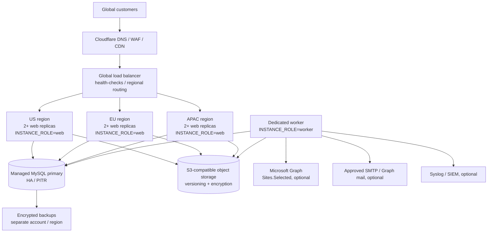

# ReadyPackets Portal — Global Growth & Horizontal Scaling Architecture

**Status:** Implemented scale-out baseline; deployment validation required — October 16, 2026
**Applies to:** The self-hosted ReadyPackets Portal on `my.readypackets.com` and/or `portal.readypackets.com`
**Does not apply to:** The separate static marketing website on `www.readypackets.com`

> **Goal:** Support regional growth without weakening the portal’s security, data-residency, auditability, or self-hosted operation model. Scaling is based on multiple identical, stateless web replicas, shared durable services, and a separately controlled worker role.

## 1. What changes at scale

A single VPS is an appropriate starting deployment. It is not the correct final architecture once traffic, file volume, recovery targets, or geographic latency require more capacity. The portal is now configured so that **web replicas do not own request-local state**:

| Concern | Scale-out design | Why it works across replicas |
| --- | --- | --- |
| Authentication | Signed `__Host-` cookie plus authoritative `user_sessions` record in MySQL | Any healthy web replica can validate, revoke, expire, and rotate the same session. No load-balancer stickiness is required. |
| Customer and order data | MySQL primary database | Application mutations remain strongly consistent through one write authority. |
| Files | S3-compatible object storage when `STORAGE_DRIVER=s3` | Objects are addressed by random keys and available to every approved regional replica. Local disk is retained only for single-node operation. |
| Background processing | One or more `INSTANCE_ROLE=worker` instances | Database-backed queues plus MySQL advisory locks ensure only one worker executes a given scheduler job at a time. |
| Web requests | `INSTANCE_ROLE=web` instances behind a health-checked load balancer | Web-only replicas serve API/client requests and never start timers or own background work. |
| Audit and security events | MySQL audit tables plus structured log shipping | The existing Security Centre remains complete regardless of which replica handled the request. |
| Rate limiting | CDN/WAF at the edge plus portal progressive penalties in MySQL | Edge controls provide globally consistent per-IP controls before origin capacity is consumed; portal penalties remain durable. |

## 2. Reference topology



## 3. Scale-out deployment pattern

### Web replicas

Deploy the same immutable Portal image or reviewed Git commit to at least two web replicas in the primary region.

```dotenv
INSTANCE_ROLE=web
DATABASE_CONNECTION_LIMIT=8
STORAGE_DRIVER=s3
```

- Set identical `APP_URL`, session secret, encryption key, email blind-index key, and data-storage configuration on every replica.
- Do **not** place customer files on a replica-local disk once more than one replica serves traffic.
- Route load-balancer readiness checks to `GET /api/health/ready` with the correct `Host` header.
- Terminate public TLS at the edge/load balancer, then re-encrypt to the regional origin. Lock origin ingress down to the load balancer or Cloudflare address ranges.
- Do not use cookie-affinity/sticky sessions as a substitute for correct shared state. The portal session model is already database-authoritative.

### Worker role

Run one worker replica initially.

```dotenv
INSTANCE_ROLE=worker
DATABASE_CONNECTION_LIMIT=12
STORAGE_DRIVER=s3
```

The worker owns email delivery, workflow completion, SharePoint sync, conversion, webhooks, cleanup, and health checks. If an operator deliberately deploys a standby worker in another availability zone, the database advisory locks prevent the two workers from processing the same scheduled job concurrently. Keep the standby’s capacity reserved and verify failover regularly.

### Database

Use a production MySQL service with high availability, automatic backups, point-in-time recovery, encryption at rest, private networking, and monitored connection limits. The application has one write path; therefore:

- Use the primary writer for all portal mutations and security/session checks.
- Introduce read replicas only after measuring read pressure and after explicitly reviewing each read path for replica lag tolerance.
- Size `DATABASE_CONNECTION_LIMIT × replica count` below the database connection budget, leaving capacity for migrations, backups, and administration.
- Run migrations exactly once per release from a controlled deployment job before expanding web replicas. Do not allow every replica to attempt DDL independently.

### Object storage

Use an S3-compatible service that supports private buckets, encryption, versioning, lifecycle policies, regional replication where required, and recovery controls. MinIO is supported for an operator-managed/self-hosted object store.

```dotenv
STORAGE_DRIVER=s3
S3_ENDPOINT=https://object-storage.example.net
S3_REGION=us-east-1
S3_BUCKET=readypackets-production
S3_ACCESS_KEY_ID=<least-privilege application identity>
S3_SECRET_ACCESS_KEY=<protected secret>
S3_FORCE_PATH_STYLE=false
```

The application never exposes bucket objects directly. Downloads still pass through ReadyPackets authorization and attachment-disposition controls. Give the application identity only bucket-scoped `GetObject`, `PutObject`, `HeadObject`, `DeleteObject`, and `ListBucket` access; do not give it account, bucket-policy, or key-management administration rights. Full and scoped recovery archives export the hash-verified opaque object tree through the same backend adapter, so restore drills can move local-disk data into a target shared bucket or return shared objects to an isolated local-storage drill without importing source-cloud credentials.

## 4. Regional rollout sequence

| Phase | Scope | Exit criteria |
| --- | --- | --- |
| 0 — Baseline | One hardened portal instance, one primary database, backups/restore tests | Current single-region service passes health, security, backup, and recovery tests. |
| 1 — Horizontal web scale | Two web replicas in one region + one worker | Load balancer drains/replaces a web replica without session loss or duplicated jobs. |
| 2 — Durable storage | Move uploads to private S3-compatible storage | A file uploaded through one replica downloads correctly through another; restore test includes object data. |
| 3 — HA data | Managed MySQL HA / primary failover and point-in-time recovery | Tested failover meets RTO; quarterly restoration meets RPO. |
| 4 — Global edge | Cloudflare/global load balancer routes customers to regional web pools | Web replicas remain stateless; origin access is restricted; edge WAF/rate limits are enforced. |
| 5 — Additional regions | Add regional web pool and compliant storage/DB replication plan | Data residency, latency, legal, privacy, and failover design are signed off per region. |

## 5. Data residency and compliance

Global routing must not silently move regulated data across borders. Before enabling any new region, document:

1. the customer/data classifications it may serve;
2. where MySQL primary, replicas, object storage, backups, logs, and SIEM data reside;
3. encryption-key custody and access approvals;
4. retention/deletion obligations and subject-access workflows;
5. Microsoft Graph, SMTP, payment-provider, and analytics processor regions and data-processing terms;
6. the legal review for applicable privacy, consumer, accessibility, tax, and export-control rules.

A regional compute replica does not by itself satisfy data-residency requirements if it connects to a database or object store in another geography.

## 6. Security controls that remain mandatory

- Maintain TLS from visitor to edge and edge/load balancer to origin; use authenticated origin certificates where applicable.
- Keep MySQL and object storage private; never expose their management ports to the internet.
- Keep the session/encryption/index secrets identical only within the intended production trust boundary and protect them with a real secret-management service or encrypted host configuration.
- Retain MFA, administrator IP controls, CSP, CSRF, host validation, secure cookies, and audit logging on every replica.
- Configure Cloudflare/WAF global rate limits before traffic reaches the portal. Portal-side progressive penalties are defence in depth, not a replacement for an edge WAF.
- Send structured logs to a central SIEM through protected network paths. Do not transmit secrets, tokens, document bodies, customer-file names, or encrypted values in logs.
- Run dependency scanning, image scanning, IaC review, secret scanning, automated tests, database migration checks, and deployment health/security probes in the release pipeline. The release gate must fail if `pnpm audit --prod` reports any production vulnerability until it is patched or an explicitly documented, time-bounded risk exception is approved.

## 7. Operational readiness checks

Before calling a multi-region rollout production-ready, prove each item through an exercise:

- [ ] Web replica loss does not log out an active customer or lose an in-flight safe retry.
- [ ] A duplicate worker cannot send duplicate email, webhook, SharePoint transfer, or conversion result.
- [ ] A file written through replica A can be authorized and downloaded through replica B.
- [ ] The database primary can fail over within the documented recovery objective.
- [ ] A regional failure routes only eligible traffic to a healthy region and protects data-residency commitments.
- [ ] Restores recover MySQL, encrypted configuration, and object data into an isolated environment.
- [ ] Central logging, audit search, and alerting remain complete through a regional failover.
- [ ] Load, concurrency, upload, conversion, and authentication tests establish capacity before public campaigns.
- [ ] The production dependency audit is clean, and container/base-image scanning has been run for the exact immutable release artifact.

## 8. Deliberate limits

This architecture provides a secure path to horizontal web scale. It does **not** claim that a single MySQL primary becomes globally write-local or that geographic replicas remove legal/data-residency obligations. Multi-primary writes, asynchronous replica reads, cross-region active-active databases, and cross-region worker execution require measured load tests, conflict/lag analysis, a disaster-recovery design, and a formal security/privacy review before activation.
