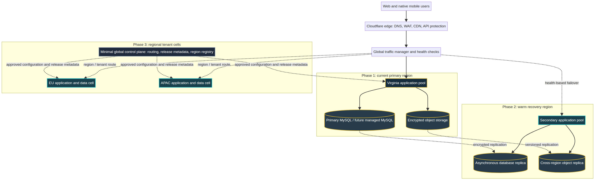
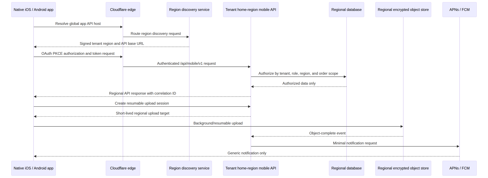

# ReadyPackets Global Growth and Native Mobile Architecture Plan

**Document status:** Architecture and implementation roadmap

**Audience:** ReadyPackets leadership, infrastructure administrators, security owners, and mobile engineering teams

**Scope:** Growth from the current single Virginia origin to a resilient, region-aware customer platform that supports native iOS and Android applications without changing the platform’s self-hosted security and data-ownership principles.

## Executive conclusion

ReadyPackets is **ready to serve international users today**, but it is **not yet a multi-region application**. Cloudflare’s proxy already gives users globally distributed DNS, TLS termination, DDoS/WAF controls, and edge delivery for suitable public/static traffic. The application, database, encrypted file storage, background work, and order writes still have a single Virginia origin. Consequently, authenticated portal actions, uploads, audio recording, administrative work, and mobile API calls are bounded by the latency, availability, and data-residency characteristics of that origin.

> The recommended path is **not** to deploy an independent writable server on every continent. Start by measuring actual demand; strengthen the single primary region; add a tested warm recovery region; then introduce region-owned tenant cells when customer density, latency, contractual data residency, or recovery objectives justify it. This avoids premature multi-primary database complexity and preserves ReadyPackets’ authorization, encryption, and audit guarantees.

Cloudflare Load Balancing can distribute traffic to healthy origins, apply active monitoring, and steer traffic by latency or geography.[1] Geo steering routes users to configured geographic pools with ordered failover.[2] The traffic layer alone does **not** solve data consistency: a regional application server needs an explicit and correct data-ownership model before it can accept writes.

## 1. Current-state assessment

The existing application has several favorable foundations. It is self-hosted, deployable by an idempotent installer, protected by Cloudflare when proxied, built around a server-side authorization model, uses encrypted sensitive fields, maintains audit/security logs, supports a protected full backup/restore process, and now stops installation when a critical database schema contract is incomplete. It also has a native-mobile architecture foundation that separates mobile authentication/API contracts from browser cookies and CSRF rules.

The current deployment remains a **single write region**. The React client, Express/tRPC application, MySQL database, encrypted file storage, scheduled jobs, email/SharePoint integration execution, and backup helper live behind one Virginia origin. Cloudflare makes the route into that origin faster and safer, but it cannot make an authenticated database transaction execute locally in Europe, Asia-Pacific, or another continent.

| Architecture area | Current position | Suitable today | Gap before multi-region writes |
|---|---|---|---|
| Edge and public delivery | Cloudflare-proxied DNS, TLS, WAF capability, CDN-adjacent delivery | Global public website access and origin protection | Explicit cache rules, origin-pool health checks, traffic analytics, and regional steering policy. |
| Application execution | One nginx/Node.js origin in Virginia | International pilot/customer use | Regional deployment definition, stateless app pools, release promotion, and health-gated failover. |
| Database | One MySQL write authority | Single-region transactional correctness | Replication strategy, recovery objectives, regional data ownership, and controlled promotion. |
| Files and audio | Local encrypted storage with optional S3-compatible target | Current portal workflow | Regionally durable object storage, upload locality, replication/versioning, and lifecycle policy. |
| Background work | Server-local jobs, webhooks, email, and sync processing | One-region operations | Durable queue/outbox, worker isolation, idempotent regional execution, and replay controls. |
| Identity and sessions | Server-authorized browser and mobile identity model | One-region customer/staff access | Region-aware session/token validation, centralized revocation or short-lived regional caches. |
| Observability | Application health, audit/security logs, and operational logs | Local incident response | Global SLOs, regional telemetry, trace/correlation propagation, synthetic probes, and failover runbooks. |
| Native mobile | Native client/API foundation and security model | Controlled implementation and test rollout | Regional API discovery, resilient upload/sync, push, app-link verification, store release operations. |

## 2. What “global” should mean for ReadyPackets

Global growth has four distinct objectives. They should not be combined into one expensive infrastructure change.

| Objective | Meaning | First technical answer |
|---|---|---|
| **Global access** | A user in another country can reach the portal securely and quickly. | Cloudflare proxy, optimized static/public delivery, origin health monitoring, and performance measurement. |
| **Regional availability** | A Virginia failure does not require rebuilding the company from a backup. | Warm standby in a second region, replicated data, practiced failover, and defined RTO/RPO. |
| **Regional performance** | Authenticated/API/upload traffic is processed closer to a customer. | Regional application pools plus region-appropriate data/storage; do not route only the app tier locally while every write crosses an ocean. |
| **Data residency** | A customer or contract requires personal/business data to remain in a defined geography. | Tenant home-region assignment and independent regional data cells, not merely geo steering. |

Data residency is a product, legal, contractual, and operational commitment. For example, the European Commission explains that transfers of personal data outside the EEA require appropriate safeguards under the relevant framework.[3] ReadyPackets should obtain jurisdiction-specific legal advice before promising country/region storage or support-access restrictions; the engineering design should make those promises enforceable instead of relying on policy text alone.

## 3. Recommended target topology

The target should remain **single-writer by tenant**. At first, every tenant belongs to the Virginia cell. A later EU tenant belongs to an EU cell, and an APAC tenant belongs to an APAC cell. Each cell owns the tenant’s transactional database records, encrypted file objects, queue events, and encryption-key references. There is no global MySQL multi-master cluster.

### 3.1 Global edge layer

Cloudflare remains the only public entry point. It should provide authoritative DNS, proxied TLS, DDoS controls, WAF, bot/rate controls, managed rules, and health-aware origin selection. Cache only public and explicitly safe content. Never edge-cache authenticated portal HTML, personalized API responses, file downloads, authorization decisions, CSRF tokens, or payment/order mutation responses.

When ReadyPackets has a secondary origin, configure Cloudflare Load Balancing with a dedicated `/api/health/ready` monitor, expected body/status matching, short but non-flapping intervals, and a documented failover policy. Cloudflare supports healthy-endpoint failover and configurable active monitoring.[1] Geo steering can later select a nearby regional pool, but routes must still honor the tenant home region; a visitor’s location must not override a customer’s data-residency assignment.[2]

### 3.2 Regional application cell

Every regional cell should be reproducible from the same reviewed source release and Infrastructure as Code definition. A cell contains stateless application instances, regional workers, regional object storage, a tenant-scoped relational data store, secret references in a regional vault/KMS, private networking, and independent health/telemetry collection.

The Node.js server should not retain authoritative queued work, session revocation lists, rate-limit state, or upload state only in process memory once multiple instances exist. Move those concerns to durable/shared services or authoritative database tables. The existing database audit, idempotency, and job patterns are useful starting points, but production multi-instance use should place job leasing, retry, and lock ownership under an explicit durable queue/outbox contract.

### 3.3 Data plane and storage plane

Use a managed MySQL-compatible service or a self-operated MySQL topology only when the operating team can meet its replication, restore, patching, monitoring, encryption, and promotion requirements. The desired early multi-region state is **active/passive**: Virginia remains the write primary, a second region receives asynchronous replica data and replicated encrypted objects, and Cloudflare fails over only when the recovery process has promoted a coherent secondary write authority.

AWS describes backup/restore, pilot-light, warm-standby, and multi-site active/active recovery patterns as progressively more complex choices.[4] For ReadyPackets, warm standby is the most appropriate intermediate design: keep a smaller but functional secondary cell, continuously replicate what is necessary, preserve point-in-time backups, and execute rehearsed promotion. Active/active becomes appropriate only after tenant-cell isolation and conflict-free write ownership are established.

Object storage should move from a server-local directory to a private, encrypted, versioned S3-compatible/object-storage target before regional scale. The application must continue to authorize every file request; object storage is not a public download origin. Use temporary scoped upload/download capabilities, checksum verification, malware/file-type controls, lifecycle rules, immutable backup versions, and replication that is measured rather than assumed.

### 3.4 Global control plane

Keep the global control plane intentionally small. It may hold release manifests, signed configuration metadata, region registry data, tenant-to-home-region mapping, global account identifiers, and public API discovery metadata. It should not become a hidden global database containing full order content, encrypted customer fields, sensitive files, or all application secrets.

A control plane can be unavailable without taking every regional data plane down if regional cells retain their current authorized configuration and requests are directed to the assigned tenant home region. Use signed, versioned configuration releases with explicit rollback rather than manual edits in each region.

## 4. Native mobile implications

The native apps must not assume that one hard-coded Virginia API endpoint serves every tenant forever. Add a low-risk discovery endpoint, for example `https://api.readypackets.com/.well-known/ready-packets-region`, that returns the signed public metadata necessary to select an API base URL. The response must contain no customer data and should be cacheable only for a short controlled period.

| Mobile capability | Required global design |
|---|---|
| Authentication | System-browser OAuth/OIDC with PKCE, verified universal links/App Links, short-lived access tokens, rotating refresh tokens, region-aware issuer/API routing, and centralized or consistently replicated revocation. |
| Order and portal APIs | Every request includes an opaque account/tenant context resolved server-side. The gateway routes to the tenant home region; the app does not choose data geography from GPS. |
| File, document, and audio upload | Create a server-authorized regional upload session, then use resumable/background transfer. Use idempotency keys, checksums, bounded retries, and a durable completion event. |
| iOS resilience | Use one or a small number of background `URLSession` transfers for nonurgent downloads/uploads. Apple documents that background sessions continue transfer work while the app is suspended and can relaunch the app to deliver completion events.[5] |
| Android resilience | Use WorkManager for durable synchronization/retry work that must survive app exits and device restarts; Android documents that it persists scheduled work and supports constraints plus retry/backoff.[6] |
| Push notifications | Deliver only generic, minimal payloads through APNs/FCM. On receipt, the app must fetch the authorized current state from the tenant home region. Do not place names, file names, order details, or access tokens in push payloads. |
| Offline behavior | Cache only the minimum encrypted, revocable data necessary for an approved offline experience. Queue mutations with idempotency keys; handle server conflict decisions explicitly. Do not make mobile clients an independent source of truth. |

## 5. Phased implementation roadmap

### Phase 0 — Measure and stabilize the Virginia primary

This phase is required before adding regions. It addresses performance with less risk than database distribution.

| Workstream | Deliverable | Exit criterion |
|---|---|---|
| Performance measurement | Real-user metrics segmented by country/network; synthetic probes from North America, Europe, APAC, and target markets | A 30-day baseline exists for page load, API latency, upload completion, error rate, and origin utilization. |
| Cloudflare tuning | Explicit cache rules for safe public assets only, WAF/rate controls, bot posture, origin protection, and analytics dashboard | Authenticated/API routes are verified non-cacheable; public/static content is cached correctly. |
| Origin reliability | Separate health and readiness probes, resource alerts, log retention, capacity alerts, and an operational on-call/incident runbook | A simulated application process failure is detected and recovered without customer-data loss. |
| Storage readiness | Move/validate files against encrypted object storage, record object checksums, define lifecycle and versioning | A file restore drill validates both metadata and objects. |
| Delivery discipline | Immutable release artifact, rollback, migration contract, SBOM/dependency review, and backup restore drill | Release and restore drills meet stated RTO/RPO targets. |

Do not add a second serving region until usage or a business commitment demonstrates a need. A Cloudflare-proxied Virginia origin is often sufficient for initial international traffic if authenticated response times and availability remain within agreed objectives.

### Phase 1 — Add regional recovery, not regional writes

Build a warm standby in a second geography chosen for recovery and customer demand, such as U.S. West or Europe. Replicate database data asynchronously, replicate versioned encrypted objects, and deploy a reduced-capacity but fully tested application/worker stack. Keep Virginia as the only writable primary.

Define explicit recovery objectives before purchasing/building the standby. For example, leadership may choose an RPO of 15 minutes and an RTO of four hours; those are business choices, not architecture facts. Instrument replication lag, backup freshness, object replication, restore eligibility, and promotion steps against the selected targets.

Failover must be a rehearsed operation. It should fence the failed primary, confirm promotion eligibility, promote the database/storage write authority, deploy/scale the secondary app workers, redirect traffic through Cloudflare, invalidate or reissue affected sessions as required, reconcile durable queues, and record the incident/audit trail. Do not automate full write failover until multiple controlled drills demonstrate that the false-positive and split-brain risks are understood.

### Phase 2 — Regional performance for selected markets

Add a regional application pool only when telemetry demonstrates sustained demand, not merely because visitors exist there. The initial pattern can be regional read/API acceleration for data that has an appropriate replication and consistency model, while write operations remain routed to the tenant primary. This phase requires a durable cache/queue strategy and observability that distinguishes edge latency, application latency, database time, upload time, and third-party integration time.

Select regions based on a documented scorecard: active users, transaction volume, upload volume, p95 latency, revenue/customer commitments, legal requirements, operating support coverage, cloud cost, and recovery value. Do not deploy to a continent without a defined owner, monitoring path, patching window, backup policy, and incident runbook.

### Phase 3 — Tenant home-region data cells

Introduce this phase when ReadyPackets must make enforceable regional storage commitments or has enough regional scale to justify local writes. New tenants select or are assigned a home region at provisioning. Existing tenants migrate only through a controlled export/replication/validation/cutover process with customer communication, a rollback window, and audit evidence.

A cell needs its own database, object storage, worker queue, encryption-key scope, backup/restore plan, telemetry, and deployment policy. A tenant’s order content, files, recordings, messages, and encrypted PII remain in that tenant’s cell. Global services store only the minimum routing and identity metadata. Cross-region support access must be explicitly approved, logged, time-bounded, and technically restricted.

### Phase 4 — Mature global operations

Only after tenant cells operate reliably should ReadyPackets evaluate active/active service at the cell level. “Active/active” should mean multiple independent tenant-owned cells are simultaneously serving their assigned tenants, not multiple sites writing the same tenant/order records without a conflict model.

At this stage, add regional service-level objectives, chaos/failover drills, quarterly recovery exercises, region-scoped feature flags, policy/configuration promotion, capacity forecasting, cost allocation, customer region selection, data-export portability, and a formal regional retirement/migration process.

## 6. Required application changes before Phase 2/3

| Domain | Required change | Why it is necessary |
|---|---|---|
| Tenant model | Add an immutable `home_region`/cell identifier to tenant/customer scope, with migration history and controlled change workflow | Gives every authorization, storage, API, queue, and backup operation an enforceable data owner. |
| APIs | Publish versioned REST/mobile DTOs, regional discovery, correlation IDs, idempotency for all mobile writes, and explicit deprecation policy | Avoids browser/session assumptions and supports independent native releases. |
| Authentication | Centralize issuer/key rotation or establish signed regional verification; preserve revocation and MFA/security events across failover | Prevents regional login/session inconsistency. |
| Background work | Implement transactional outbox plus durable queue worker leasing; make every integration delivery idempotent and region-aware | Prevents duplicate/lost webhooks, email, and SharePoint sync after retries/failover. |
| Storage | Object storage abstraction with region, checksum, content disposition, lifecycle, replication state, and authorized transfer sessions | Supports resilient file/audio operations without exposing storage. |
| Database | Migration automation, replication monitoring, point-in-time recovery, promotion/fencing runbook, and region-specific backup drills | Makes failure recovery real rather than conceptual. |
| Encryption | Use a per-region key reference and documented key-recovery/material rotation model; preserve historical decryptability | Supports cell isolation without losing old encrypted data. |
| Observability | OpenTelemetry-style trace/correlation propagation, regional dashboards, synthetic tests, SLO/error-budget alerts, and audit export | Identifies whether a failure is edge, origin, data, storage, or integration related. |
| Administration | Region-aware dashboards and role permissions; no global administrator should automatically gain unlogged access to every cell | Preserves least privilege and residency controls. |
| Release engineering | Immutable artifacts, region-by-region progressive rollout, automatic health gate, schema compatibility window, and rollback | Prevents a global incident from one deployment. |

## 7. Security and compliance guardrails

The global architecture must retain existing ReadyPackets controls: encrypted sensitive fields, HMAC blind indexes, MFA, non-exportable server secrets, nonce CSP, CSRF for browser routes, API authorization, audit logging, backup checksums, and protected restore procedures. Regional growth adds controls; it does not replace them.

| Risk | Required guardrail |
|---|---|
| Split-brain writes after failover | One write authority per tenant; explicit primary fencing before promotion; immutable event/idempotency records. |
| Unintended cross-border access | Tenant home-region routing enforced server-side; region-scoped storage/keys; time-bounded audited support access. |
| Regional secret sprawl | Vault/KMS references per region; no keys in Git, mobile binaries, environment exports, or cross-region log payloads. |
| File exposure through CDN/object storage | Private buckets/containers, server authorization, short-lived scoped transfers, cache-control rules, and access logging. |
| Global token/session compromise | Short-lived access tokens, rotating refresh tokens, device/session revocation, regional anomaly detection, and shared incident response. |
| Mobile retry duplication | Idempotency keys, durable upload/session state, content checksums, server-defined conflict behavior, and audit events. |
| Regulatory overstatement | Treat residency as an engineering capability plus legal/contractual review, not a marketing statement until the complete operating model is approved. |

## 8. Decision gates and next actions

The next technical action should be **Phase 0**, not a second continent deployment. Establish the measurable evidence needed to make a responsible capacity decision.

| Priority | Decision or action | Accountable outcome |
|---:|---|---|
| 1 | Define business RTO/RPO, target markets, anticipated active users, upload volume, and legal/residency commitments | Architecture choices have measurable success criteria. |
| 2 | Add global synthetic probes and real-user metrics; baseline p50/p95/p99 API, upload, and page timings by country | Determine whether Virginia plus Cloudflare is sufficient. |
| 3 | Configure safe Cloudflare cache/WAF/health policies and protect origins so only Cloudflare can reach public HTTPS where feasible | Improve global access and origin resilience without data-plane redesign. |
| 4 | Move/validate customer artifacts on private encrypted object storage with versioning and restore drills | Remove server-local file storage as the first regional bottleneck. |
| 5 | Build an Infrastructure as Code definition and a tested warm standby cell | Make regional recovery repeatable. |
| 6 | Complete the versioned mobile API, regional discovery, resumable upload, device/push, and store-release gates | Support native apps without coupling them to the browser portal. |
| 7 | Decide whether customer contracts require selectable data residency | If yes, design tenant cells before selling the commitment. |

## 9. Answer to the immediate question

**You do not need servers on every continent today.** Continue using the Virginia primary behind Cloudflare while you measure global user experience and harden recovery. Add a second warm region before adding multiple serving regions. Add regional tenant cells only when you have sustained demand or a contractual/legal reason for local data processing. The main architectural changes are a regional tenant/data-ownership model, durable shared background-work infrastructure, region-aware object storage and backups, explicit database replication/promotion, global observability, and a versioned mobile API with resilient upload/sync behavior.

## References

[1]: https://developers.cloudflare.com/load-balancing/ "Cloudflare Load Balancing"
[2]: https://developers.cloudflare.com/load-balancing/understand-basics/traffic-steering/steering-policies/geo-steering/ "Cloudflare Geo Steering"
[3]: https://commission.europa.eu/law/law-topic/data-protection/international-dimension-data-protection/rules-international-transfers_en "European Commission: Rules on international data transfers"
[4]: https://docs.aws.amazon.com/whitepapers/latest/disaster-recovery-workloads-on-aws/disaster-recovery-options-in-the-cloud.html "AWS: Disaster recovery options in the cloud"
[5]: https://developer.apple.com/documentation/foundation/downloading-files-in-the-background "Apple: Downloading files in the background"
[6]: https://developer.android.com/develop/background-work/background-tasks/persistent "Android: Persistent background work with WorkManager"
