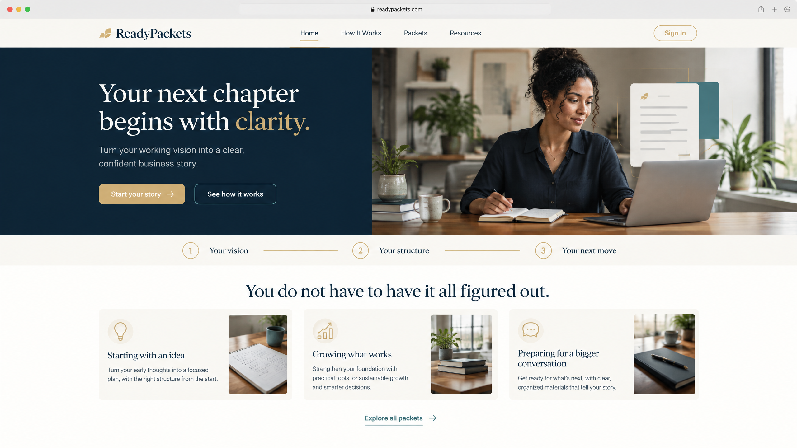
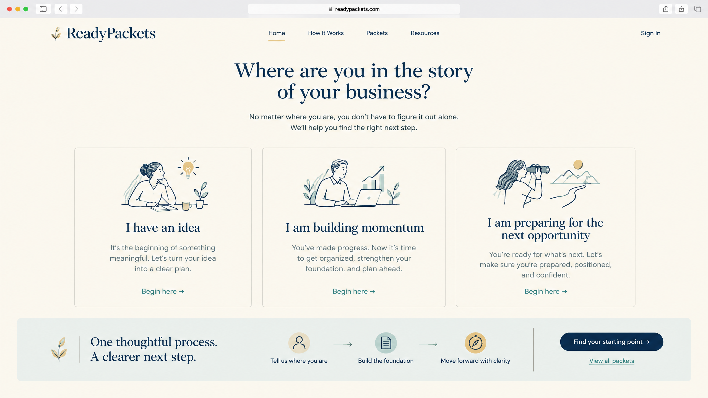
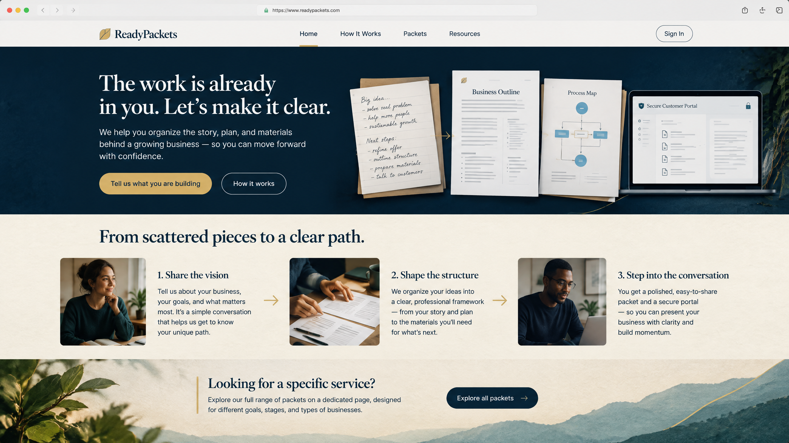

# ReadyPackets Homepage Redesign — Preview Concepts

**Status:** Design exploration only. **No production homepage code has been changed.**  
**Objective:** Make the first visit feel more welcoming and story-led, while moving the full packet catalogue and product tiers to the existing dedicated **Packets** page.

## Shared design direction

Each preview retains ReadyPackets’ professional navy, off-white, restrained gold, and teal palette; introduces a more human first impression; and removes the current homepage’s product-card catalogue grid. In every direction, the navigation retains **Packets**, and a clear secondary call to action directs visitors to the full catalogue at `/packets`.

The redesigned homepage would instead answer a customer’s early questions in a more natural order:

1. **Do you understand where I am right now?**
2. **Can you help me create clarity and structure?**
3. **What does the engagement feel like?**
4. **Where do I explore the specific services and tiers?**

## Preview 1 — The Founder’s Moment

**Core idea:** A welcoming editorial introduction that starts with a single human founder and the reassuring message, “Your next chapter begins with clarity.” The customer sees a simple progression from vision to structure to their next move, followed by three relatable entry points: starting with an idea, growing what works, or preparing for a bigger conversation.

| Strength | Consideration |
| --- | --- |
| The strongest human connection at first glance; the page feels immediately personal and premium. | The hero photograph needs a professionally licensed or original ReadyPackets-approved image or a well-directed editorial shoot. |
| The three-part progression is easy to understand and works well on mobile. | The messaging needs careful final copy approval so the promise stays accurate and does not imply guaranteed outcomes. |
| It creates a clear visual separation between the welcoming home page and the service catalogue. | The card imagery should be tailored to ReadyPackets rather than left as generic stock photography. |

**Best for:** A polished brand-first homepage that should feel warm, reassuring, and aspirational without becoming overly sales-focused.

## Preview 2 — The Guided Path

**Core idea:** The homepage starts by asking, “Where are you in the story of your business?” Visitors self-identify with one of three clear stages—having an idea, building momentum, or preparing for the next opportunity—then take a guided route to the most relevant starting point.

| Strength | Consideration |
| --- | --- |
| Most immediately interactive and easiest for a visitor who does not yet know which ReadyPackets service they need. | Requires a simple content-mapping decision: each starting point must direct to an approved page, short discovery form, or filtered Packet view. |
| Low-pressure, welcoming language makes the site feel like guidance rather than a catalogue. | The illustrations must remain consistent in style and inclusive across the final desktop and mobile layouts. |
| The service catalogue stays fully separate while the homepage still supports discovery. | It is more “navigator” than “brand story,” so a later section should add a little ReadyPackets personality and proof. |

**Best for:** A conversion-oriented homepage intended to help unfamiliar visitors choose a relevant first step quickly.

## Preview 3 — Prepared, Together

**Core idea:** A narrative page showing the transformation from notes and ideas into an organized plan, process, and customer portal experience. It opens with “The work is already in you. Let’s make it clear,” then walks the visitor through three chapters: share the vision, shape the structure, and step into the conversation.

| Strength | Consideration |
| --- | --- |
| Best connects the ReadyPackets brand promise with the actual portal experience, without showing products as a grid. | The paper/document collage must use purpose-built fictional content or visual placeholders—never real customer materials. |
| The clearest story arc for video, audio, and the fictionalized customer-story campaign already created for ReadyPackets. | More visual storytelling means more intentional image, accessibility, and performance work during implementation. |
| The final “Explore all packets” transition gives the catalogue a deliberate, uncluttered home of its own. | The page should maintain clear text alternatives and avoid relying on images alone to explain the process. |

**Best for:** A premium, story-led brand homepage that makes ReadyPackets feel thoughtful, practical, and human.

## Recommended direction

**Preview 3, “Prepared, Together,” is the strongest primary direction.** It has the most coherent customer story: a founder already has the work, then ReadyPackets helps organize that work into materials that support the next conversation. It also aligns naturally with the fictionalized video/audio campaign without presenting any invented endorsement or commercial result as fact.

A strong final implementation could combine the **visual storytelling of Preview 3** with the **three self-selection choices in Preview 2** just below the narrative process. This would create a welcoming homepage that both explains the brand and helps visitors decide where to begin.

## Proposed homepage information architecture

If a direction is approved, the implementation would replace the homepage’s current catalogue card grid with the following sequence:

| Homepage section | Purpose | Packet relationship |
| --- | --- | --- |
| **Welcome hero** | Establish the emotional promise and a clear first action. | Primary action can open a discovery route; secondary action explains the process. |
| **Customer story / founder moment** | Help prospective customers recognize their own situation without using a fabricated testimonial. | No products or prices shown. |
| **Three-step ReadyPackets process** | Explain what happens from first conversation through organized deliverables. | No products or prices shown. |
| **Choose your starting point** | Let visitors identify their current stage or goal. | Each choice can route to a filtered catalogue, an inquiry, or “How it works.” |
| **Trust and care section** | Present privacy, confidentiality, revision, and portal organization accurately. | No product grid. |
| **Explore packets callout** | Give visitors a clear, intentional path to all services, tiers, and pricing. | Single prominent button to `/packets`. |
| **Closing CTA** | Invite an approved next action such as starting a conversation or creating an account. | Links to the appropriate current flow. |

## Implementation guardrails

- Preserve the existing, dedicated `/packets` and packet-detail routes; only remove the duplicated catalogue-grid section from the homepage after approval.
- Retain current admin-controlled presentation preferences for pricing, delivery estimates, Reviews, and Community navigation.
- Do not use real customer portal screens, customer names, orders, files, invoices, or messages in visual media. Use a seeded demo environment, mock data, or designed placeholders.
- Keep all claims factual and qualified. The page should promise **clarity, organization, and a structured process**—not funding, revenue, legal protection, approval, or business success.
- Build mobile-first, preserve keyboard navigation and strong color contrast, include meaningful image alt text, and respect reduced-motion preferences.
- Optimize image assets and provide responsive alternatives so a more visual homepage does not degrade page speed.

## Decision needed before implementation

Choose one of the following options:

1. **Preview 1 — The Founder’s Moment:** human, editorial, reassuring.
2. **Preview 2 — The Guided Path:** guided, stage-based, conversion-focused.
3. **Preview 3 — Prepared, Together:** story-led, premium, closest to the recommended direction.
4. **Hybrid:** Preview 3’s narrative hero and process plus Preview 2’s “Where are you now?” selection section.

Once a direction is chosen, the approved design can be implemented in the ReadyPackets homepage while keeping the full Packet catalogue on its own page.
