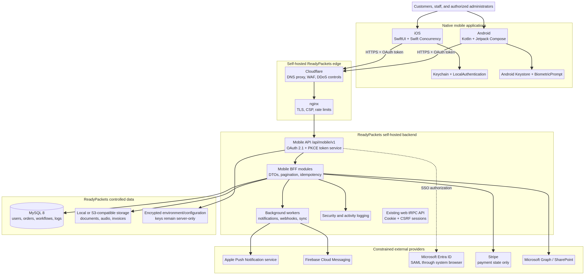
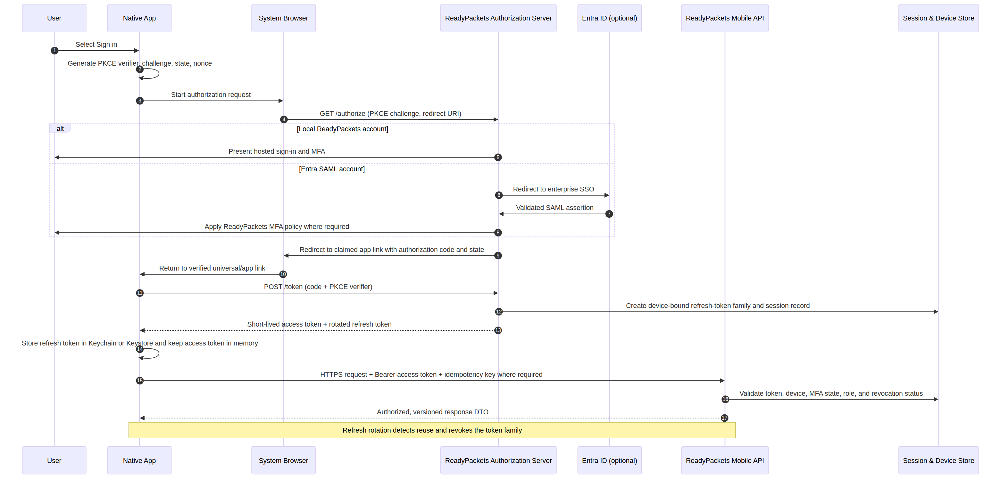
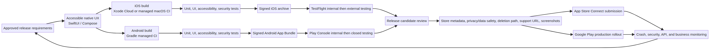

# ReadyPackets Native Mobile Architecture

**Document status:** Implementation architecture and release plan  
**Version:** 1.0  
**Prepared:** August 2026  
**Applies to:** Native iOS and Android customer, staff, and controlled administrator mobile frontends for the self-hosted ReadyPackets Portal

---

## Executive decision

ReadyPackets should deliver two **genuinely native** applications: an iOS application written in **Swift and SwiftUI** and an Android application written in **Kotlin and Jetpack Compose**. They will be independent presentation layers over a new, versioned mobile API surface hosted by the existing self-hosted ReadyPackets backend. This is not a mobile web wrapper, a PWA, a WebView shell, a React Native application, a Flutter application, or a Capacitor application.

The existing React 19, Express, tRPC, Drizzle, MySQL, nginx, Cloudflare, storage, workflow, file-delivery, audit, policy, and administrator controls remain the system of record. The native clients add device-grade security storage, biometric re-entry, reliable background uploads, native audio recording, universal/app links, push notifications, and App Store/Google Play distribution without moving customer records, encryption keys, or integration secrets into a device.

> **Core principle:** Mobile applications are untrusted clients. ReadyPackets authorization, file access, workflow state, payment state, policy enforcement, audit logging, encryption, and business rules continue to be enforced by the self-hosted server.

## Scope and product boundary

The first public release should be a **mobile companion for authenticated work**, not a second implementation of every administrator screen or a native commerce checkout. It should let customers securely manage orders, complete permitted workflow activities, upload files, record audio, read messages, view approved documents and invoices, monitor progress, manage their profile/security, and receive notifications. Staff may receive a reviewed work queue, secure document review, customer messaging, alerts, and limited approved order actions. High-impact administrator controls—such as production backup restore, encryption-key management, payment refunds, user purges, deployment upgrades, and platform-wide policy changes—remain web-only in the first release.

This boundary reduces review risk and avoids an unverified mobile-store payment interpretation. ReadyPackets sells digital deliverables and consulting services; native checkout must be designed and reviewed against each store’s applicable payment rules before it is released. The first mobile release should show payment/order status and route an explicitly approved external payment experience through the system browser only where legally and store-policy appropriate. It must not create a hidden or misleading workaround for store payment rules. Apple reviews payments under its App Review Guidelines, and all submission behavior must be assessed against the current version at release time. [1]

| Release area | Version 1 | Later release candidate | Web-only unless explicitly approved |
|---|---|---|---|
| Customer dashboard, orders, progress, messages | Yes | Enhancements | — |
| Workflow tasks, documents, uploads, audio recording | Yes | Offline queue refinements | — |
| Notifications, support, referral status, invoices | Yes | Rich actions | — |
| Staff queue and order review | Controlled role-based subset | More staff actions | — |
| Administrator overview and alerts | Read-only/minimal actions | Role-reviewed expansion | Backups, restore, deletion, refund, upgrades, encryption, global settings |
| Checkout or purchasing | Status only | Store-policy-approved implementation | No unreviewed Stripe checkout embedded in the app |
| Community/knowledge features | Read-only approved content | Moderated participation | Unmoderated or anonymous community functions |

## Architecture at a glance

[View editable Mermaid source](diagrams/mobile-system-architecture.mmd)

The diagram separates native applications, the Cloudflare/nginx edge, a new mobile API boundary, existing backend modules, system-of-record data, and constrained external providers. Cloudflare remains the public edge; nginx terminates the origin-side TLS configuration and forwards only to the loopback-bound ReadyPackets service. The mobile API is introduced **inside** the existing application rather than as a public direct database, MySQL, S3, or third-party-provider interface.

## Platform architecture

### iOS application

The iOS application uses **Swift 6, SwiftUI, Swift Concurrency, URLSession, Keychain Services, LocalAuthentication, AVFoundation, BackgroundTasks, and Apple’s push-notification APIs**. The minimum supported operating system should be finalized by device analytics and accessibility testing at implementation start; the build should target the then-current Xcode/SDK release required by App Store Connect.

| iOS module | Responsibility |
|---|---|
| `ReadyPacketsApp` | Composition root, dependency injection, lifecycle, scene handling, deep links. |
| `DesignSystem` | ReadyPackets navy/gold palette, typography, semantic colors, Dynamic Type, VoiceOver labels, loading/error states. |
| `AuthKit` | OAuth 2.1/OIDC authorization-code flow with PKCE, MFA continuation, SAML browser return, token rotation, logout. |
| `SecureStore` | Keychain access group, `kSecAttrAccessibleWhenUnlockedThisDeviceOnly`, token metadata, local-wipe routines. |
| `Networking` | Typed `URLSession` client, certificate/public-host validation, retry policy, idempotency, pagination and upload APIs. |
| `Orders` | Dashboard, order list, detail, progress, stage activities, documents, invoices, activity history. |
| `FilesAudio` | Media picker, file hash/metadata inspection, streamed upload, AVFoundation recording, playback, user deletion before stage lock. |
| `MessagingNotifications` | Messages, notification inbox, APNs registration, deep-link routing. |
| `SecurityProfile` | Device list, local biometric re-entry, MFA/security management handoff, policy and deletion request access. |
| `Observability` | Privacy-scrubbed crash/diagnostic instrumentation with user consent and server correlation IDs. |

### Android application

The Android application uses **Kotlin, Jetpack Compose, Coroutines and Flow, Retrofit/OkHttp, Android Keystore, BiometricPrompt, WorkManager, Media3, MediaRecorder/AudioRecord as appropriate, Activity Result APIs, and Firebase Cloud Messaging**. New submissions must target the current Google Play minimum; as of August 31, 2026, new apps and updates must target Android 16/API 36 or higher. [4]

| Android module | Responsibility |
|---|---|
| `app` | Application setup, navigation, dependency graph, activity/deep-link entry. |
| `core-design` | Compose design system, accessibility semantics, dynamic color decision, ReadyPackets visual tokens. |
| `core-auth` | PKCE, Custom Tabs, secure callback validation, token refresh, logout and device registration. |
| `core-security` | Android Keystore-backed secrets, BiometricPrompt re-entry, jailbreak/root-risk telemetry policy, local wipe. |
| `core-network` | Retrofit/OkHttp typed client, interceptors, auth refresh, idempotency, correlation IDs and redaction. |
| `feature-orders` | Customer/staff order flows, stage progress, documents, workflow actions and history. |
| `feature-files-audio` | Photo Picker/Storage Access Framework, streamed upload, audio capture/playback, WorkManager continuation. |
| `feature-messages` | Messages, notification inbox and Firebase Cloud Messaging routing. |
| `feature-profile` | Profile, device sessions, security links, account/data deletion access. |
| `feature-admin-lite` | Strictly allowlisted read-only/low-risk authorized administrator experience. |

Neither platform may store raw ReadyPackets database records, application environment files, encryption keys, Stripe secrets, SharePoint credentials, SAML certificates, Cloudflare tokens, or administrator backup archives on the device.

## Mobile API and backend integration design

### Why a dedicated mobile API is required

The web portal uses browser cookies, CSRF tokens, tRPC procedures, multipart routes, and server-rendered/admin navigation assumptions. Native mobile applications need a separately versioned, device-aware contract. The implementation should add `/api/mobile/v1` JSON resources and an OAuth 2.1/OIDC authorization server to the existing Express service while retaining the current tRPC surface unchanged for web.

Mobile handlers call the same existing domain services, authorization checks, encryption helpers, storage adapters, workflow validators, audit logger, policy engine, order services, and SharePoint/webhook services used by the web portal. They must not duplicate business rules in a second database or grant devices direct access to MySQL or storage buckets.

| API concern | Mobile design requirement |
|---|---|
| Versioning | Prefix every mobile endpoint with `/api/mobile/v1`; use additive changes within a version and publish a deprecation window. |
| Contract | Generate OpenAPI 3.1 documentation plus Swift/Kotlin clients from server DTO schemas. Do not expose raw Drizzle records or internal IDs where opaque public IDs exist. |
| Authentication | OAuth 2.1/OIDC authorization-code flow with PKCE; no resource-owner-password grant and no client secret in a mobile app. |
| Authorization | Resolve user, role, account status, MFA state, session/device status, order membership, phase locks, policy acceptance, and file permission server-side for every request. |
| Data minimization | Return mobile task-oriented DTOs, cursor pagination, explicit field selection, and short-lived download/upload capabilities. |
| Mutations | Require an `Idempotency-Key` for payment-adjacent, upload-complete, stage-submit, message-send, and device-registration mutations. |
| Error shape | Stable RFC 9457-style problem response with `code`, user-safe message, correlation ID, retryability, and field errors. Never expose stack traces, SQL, tokens, or secret values. |
| Observability | Require/request a correlation ID; log actor, public order ID, device ID, event type, outcome, and IP only as permitted by policy. Redact file names/content and PII from diagnostics. |

### Initial resource model

| Resource family | Example routes | Notes |
|---|---|---|
| Authorization | `/.well-known/openid-configuration`, `/authorize`, `/token`, `/revoke`, `/devices` | Browser-hosted sign-in page, PKCE, rotating refresh tokens, device revocation. |
| Identity | `/me`, `/me/profile`, `/me/security`, `/me/notifications`, `/me/data-deletion-request` | Native profile/security surface; account deletion requires proper confirmation and policy workflow. |
| Dashboard | `/dashboard`, `/announcements`, `/notifications` | Server aggregates permitted role-specific content. |
| Orders | `/orders`, `/orders/{publicOrderId}`, `/orders/{id}/history`, `/orders/{id}/messages` | Cursor pagination; no sequential database IDs in client-visible URLs. |
| Workflow | `/orders/{id}/stages`, `/orders/{id}/stages/{stageId}/submit`, `/unlock-status` | Server enforces configured instruction, acknowledgement, advance mode, validation, and phase locks. |
| Files/audio | `/upload-sessions`, `/upload-sessions/{id}/parts`, `/upload-sessions/{id}/complete`, `/files/{publicFileId}/download` | Hash/mime/size checks, resumable upload, permission-checked short-lived download links or authenticated stream. |
| Documents | `/orders/{id}/business-packets`, `/invoices/{id}`, `/policies` | Support in-app preview and safe native sharing only after authorization. |
| Messaging | `/conversations`, `/conversations/{id}/messages`, `/support-tickets` | Rate limit, abuse controls, audit, and UGC moderation hooks. |
| Device/push | `/devices`, `/push-tokens`, `/notification-preferences` | Push provider tokens are device registrations, not credentials. |
| Staff/admin-lite | `/staff/work-queue`, `/staff/orders/{id}/review`, `/admin/overview` | Explicit endpoint allowlist. No generic administrator router bridge. |

## Authentication, MFA, and session security

[View editable Mermaid source](diagrams/mobile-auth-sequence.mmd)

The native application opens the ReadyPackets authorization endpoint in the system browser: `ASWebAuthenticationSession` on iOS and Custom Tabs on Android. It creates a high-entropy PKCE verifier, challenge, state, nonce, and correlation ID before leaving the app. ReadyPackets authenticates the user with its existing local, SAML/Entra, password, and MFA policies. The browser returns only a short-lived authorization code to a claimed universal link or Android App Link. The app validates `state`, exchanges the code with its PKCE verifier, then stores only the refresh token in Keychain/Keystore. Access tokens stay in memory and should be brief-lived.

| Control | Required behavior |
|---|---|
| Token issuance | Short-lived access token, rotating refresh token, server-side token family/device session record, audience and scope validation. |
| Refresh reuse | Detect reuse of a rotated refresh token; revoke the token family and require reauthentication. |
| Device binding | Register a non-secret device installation ID, platform, app version, push token metadata and last-seen time. Show/revoke devices in profile/security. |
| MFA | Existing ReadyPackets MFA policy remains authoritative. Biometric unlock is local convenience only; it does not replace TOTP/Entra MFA or elevated server authorization. |
| Reauthentication | Require a fresh server-authenticated step-up for sensitive user actions such as account deletion, payment-related actions, new device recovery, or profile/security changes. |
| SAML | Use system-browser SAML; do not embed IdP sign-in in a WebView. Validate approved universal/app-link callback host/path and PKCE state. |
| Local storage | Encrypt only minimum necessary tokens and user-selected draft state. Local copies of sensitive files require explicit user action and platform-protected storage. |
| Loss/theft | Remote device revocation invalidates refresh tokens; local logout deletes secure-store items, caches, pending uploads, and decrypted previews. |

Mobile API access should use bearer tokens, not web cookies or a mobile CSRF workaround. The web portal keeps its existing cookie/CSRF architecture; the security boundaries are deliberately different.

## File, document, audio, and offline methodology

The mobile app must preserve current ReadyPackets file governance: permitted workflow capabilities, phase limits, content/mime validation, filename normalization, opaque storage references, customer/order naming rules, per-phase access controls, customer deletion until lock, administrator unlock controls, and SharePoint synchronization behavior.

Uploads begin with a server-authorized upload session that contains the order, phase, declared content type, byte limit, checksum expectation, and expiration. For local storage, the server streams the upload into protected ReadyPackets storage. For S3-compatible storage, the server may return limited, short-lived multipart URLs only after checks; finalization always returns to ReadyPackets for hash verification, malware/content pipeline hooks, audit, and workflow-state validation. The app must never determine whether a phase is complete or locked on its own.

| User experience | Native behavior |
|---|---|
| Documents/photos | Use iOS document/photo pickers and Android Photo Picker/Storage Access Framework rather than broad storage permissions. |
| Audio recording | Request microphone permission only after an explicit recording action; show preflight status, visible recording state, duration limit, waveform/level indicator, playback, delete, and retry. |
| Permission denial | Continue safely with upload or document options; show a concise Settings route. Google requires apps to handle runtime permission rejection safely. [4] |
| Background/resume | Persist encrypted upload metadata and resume only after a server session remains valid; use BackgroundTasks/WorkManager within platform rules. |
| Downloads | Preview in-memory or in an app-private encrypted/cache directory. User-initiated export uses the system share sheet/document provider and records the permitted download event. |
| Offline | Cache only user-approved, low-sensitivity metadata and explicit drafts. Do not claim full offline workflow completion. Revalidate policy, locks, and upload grants online before submission. |

## Push notifications and deep links

ReadyPackets remains the notification system of record. APNs and FCM are delivery channels only. The app registers a platform push token against a server-side device record. Backend events such as a new message, a required response, a stage update, a document available for review, a security event, or a workflow alert are evaluated against user notification preferences and authorized roles before a notification is sent.

Push payloads should contain only a generic title, minimal safe body, notification ID, and deep-link route. They must not contain customer PII, business pitch content, document names, signed URLs, access tokens, MFA codes, full order details, or payment data. On open, the app calls the API again and lets the server decide whether the destination still exists and remains authorized.

## Privacy, accessibility, and store readiness

ReadyPackets handles contact information, account identifiers, files, audio recordings, messages, purchase/order information, and diagnostics. Apple requires current privacy disclosures for data collected by the app and integrated third-party code; Apple’s guidance specifically identifies user content, audio data, identifiers, purchase history, diagnostics, and other relevant categories. [2] The Store listing must link to a public privacy policy. [2]

If the app creates or manages accounts, the iOS app must provide an in-app account-deletion path, and Google Play requires both an in-app deletion path and a public web deletion-request resource, with Data Safety/Data Deletion declarations. [3] ReadyPackets should use the existing protected account lifecycle and deletion policy as the backend, while adding a mobile account-deletion request/confirmation flow and a public, authenticated or verified web resource as required.

| Readiness control | iOS requirement | Android requirement | ReadyPackets implementation |
|---|---|---|---|
| Privacy disclosure | App Store Connect privacy details; public privacy policy [2] | Data Safety declaration | Maintain a release-owned data map tied to actual SDKs and API telemetry. |
| Account deletion | In-app path required for apps offering account creation [5] | In-app path plus web resource and Data deletion answers [3] | Reuse backend disable/trash/purge policy; explain legal retention exceptions. |
| User-generated content | Filter, report, block, contact path required where applicable [1] | Apply Play user-data/community policy | Reuse moderation, report, block, audit and response controls. |
| Review access | Fully working build, live backend, review account/demo mode, accurate metadata [1] | Review credentials/instructions where required | Create time-limited review accounts and a safe test tenant/order dataset. |
| Accessibility | VoiceOver, Dynamic Type, contrast, reduced motion, switch control | TalkBack, font scale, contrast, keyboard, large-screen/foldable layout | Make WCAG 2.2 AA the cross-platform baseline; test native semantics. |
| Device permissions | Just-in-time microphone/photo/notification explanations | Runtime permission and denial recovery [4] | Request only capabilities selected by the user. |

The app must not use tracking SDKs, advertising identifiers, or third-party analytics by default. If a privacy-scrubbed crash/analytics provider is later approved, update Apple privacy disclosures, Google Data Safety declarations, policy text, data maps, and software-bill-of-materials before release.

## Native visual and interaction design

The mobile design system translates ReadyPackets’ navy/gold identity into native semantic tokens without copying desktop layouts. Use the approved ReadyPackets logo variants, navy base surfaces, gold/cyan accents only where contrast is verified, Inter/Poppins where permitted and appropriately licensed, system typography fallback, and a documented dark/light/system theme. System appearance is the default. Maintain the product terminology **“My Business Packets”** for final customer deliverables.

Core navigation for customers should use a native tab structure: **Home**, **Orders**, **Messages**, **Notifications**, and **Profile**. An order detail is a task-oriented hierarchy: progress/status, current stage, instructions/acknowledgement, action area, files/audio, messages, history, and final My Business Packets. Staff and administrator roles receive a role-specific navigation graph from server-supplied capability flags rather than a hidden client-side feature switch.

## Quality, security, and operations

| Area | Acceptance standard |
|---|---|
| API security | OWASP API authorization tests: object-level, function-level, property-level, token, pagination, upload and rate-limit tests. |
| Mobile security | MASVS-aligned threat model; no secrets in source/build assets; secure storage; TLS hostname validation; debug logging redaction; jailbreak/root risk telemetry only if policy-approved. |
| Test layers | Shared API contract tests; iOS XCTest/XCUITest; Android JUnit/Compose UI tests; device matrix; accessibility tests; manual MFA/SAML/refresh/revocation tests. |
| Reliability | Upload resume/retry tests; network interruption; background/foreground transitions; notification deep-link authorization; expired links/tokens; session revocation. |
| Release safety | Signed artifacts, protected CI secrets, SBOM/dependency scanning, release notes, staged rollout, crash/performance rollback thresholds. |
| Server continuity | Existing backups, restore drills, migration contract, Cloudflare/nginx controls, audit logging, and service readiness remain required before mobile release. |

## CI/CD and store release process

[View editable Mermaid source](diagrams/mobile-release-pipeline.mmd)

The repository should contain separate native projects such as `mobile/ios/ReadyPackets` and `mobile/android/`. Each uses protected CI variables and independently signed artifacts. iOS production signing is handled through App Store Connect certificates/profiles or managed Xcode Cloud/macOS CI; Android upload/signing keys reside in a managed secure secret store and are not stored in the repository. The server build and mobile build are separately versioned but share a documented API compatibility matrix.

1. Define server mobile API version, database migrations, and contract tests first.
2. Build internal iOS and Android apps against a nonproduction ReadyPackets environment with a review-safe test tenant.
3. Ship internal TestFlight and Play Console internal tracks, then controlled external/closed tests.
4. Complete store metadata, screenshots from real app use, privacy/data safety disclosures, review notes, deletion links, support URL, and reviewer credentials before production submission. Apple requires complete functionality, accurate metadata, live backend services, and reviewer access for account-based apps. [1]
5. Use phased App Store release and Play staged rollout with server-side feature gates. Monitor crash-free sessions, API error rate, upload failure rate, token refresh failure, delivery latency, and support cases. Roll back by halting rollout/feature flags; do not roll back database state without the established recovery procedure.

## Implementation phases

| Phase | Primary result | Exit condition |
|---|---|---|
| 0 — Foundation | Mobile API/OIDC/PKCE, device registry, DTO schemas, audit, test tenant, CI secrets | Contract, token rotation, revocation, and authorization tests pass. |
| 1 — Customer core | Sign-in, MFA/SAML return, dashboard, orders, status, documents, messages, profile | Representative customer can complete core read/write work securely. |
| 2 — Files and audio | Resumable upload, native recording/playback, phase lock/acknowledgement, downloads | Interrupted upload, limit, delete-before-lock, playback and authorization tests pass. |
| 3 — Push and staff | Device push, deep links, notification inbox, staff queue/review | No sensitive push data; every deep link reauthorizes server-side. |
| 4 — Store hardening | Accessibility, privacy/data safety, deletion, app review accounts, beta tracks | Store readiness checklist passes on physical devices. |
| 5 — Controlled release | Phased public rollout and monitored expansion | SLOs sustained; no unresolved critical security or compliance issue. |

## Explicit non-goals and guardrails

The mobile app must not become a second backend, bypass customer payment/order controls, hold service credentials, upload directly to a storage provider without ReadyPackets authorization, accept an order ID as sufficient authorization, or show an administrator action merely because a web API exists. It must not include public references to AI, embed the full administrator portal in a WebView, re-enable a PWA service worker, make customer data available offline by default, or weaken existing MFA, encryption, audit, CSRF, rate-limit, or workflow-lock controls.

## References

[1]: https://developer.apple.com/app-store/review/guidelines/ "Apple App Review Guidelines"
[2]: https://developer.apple.com/app-store/app-privacy-details/ "Apple App privacy details"
[3]: https://support.google.com/googleplay/android-developer/answer/13327111?hl=en "Google Play account deletion requirements"
[4]: https://developer.android.com/google/play/requirements/target-sdk "Google Play target SDK requirement"
[5]: https://developer.apple.com/support/offering-account-deletion-in-your-app/ "Apple account deletion support"
