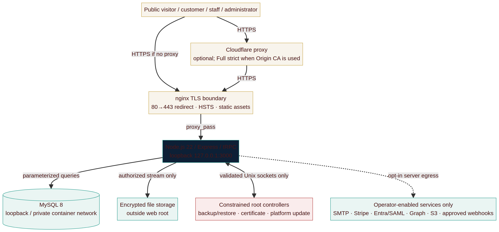
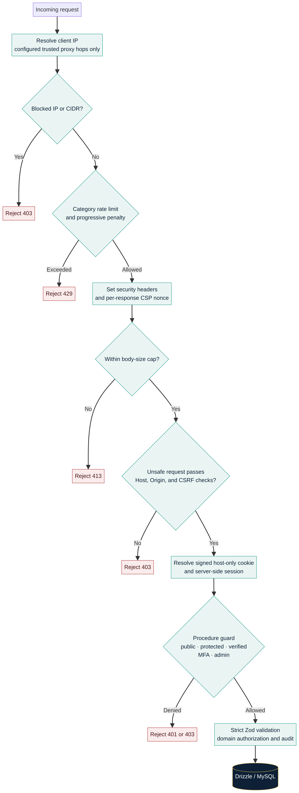
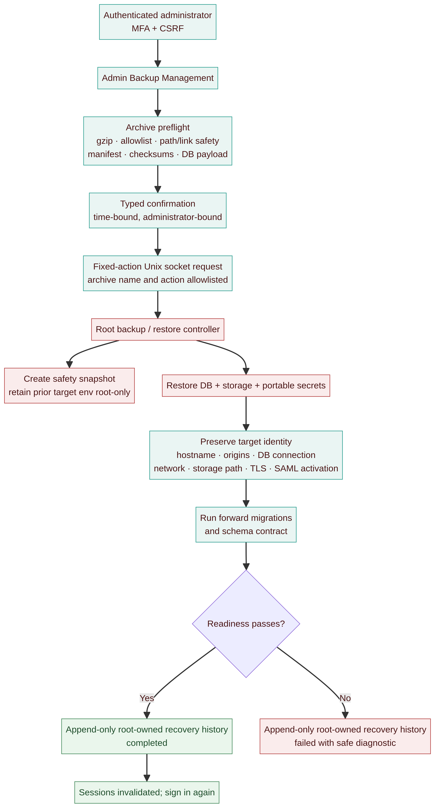
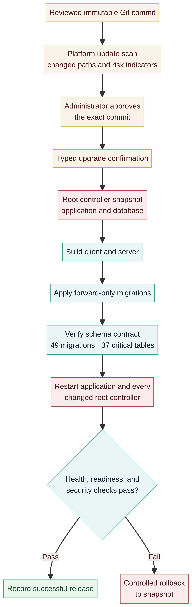

# ReadyPackets Portal — Complete Rebuild Dossier and Master Prompt

**Document status:** Current consolidated rebuild specification
**Repository baseline:** `readypackets/ReadyPackets` `main` at `b821e793ea29300b26e1f9045bc4294a83ce2ff5`
**Application type:** Self-hosted public site, customer portal, staff workspace, and administrative operations platform
**Primary deployment:** Hardened native Ubuntu VPS; Docker is supported with explicit host-operator responsibilities
**Prepared for:** ReadyPackets
**Author:** Manus AI
**Last consolidated:** 2026-09-23

> **Purpose.** This is the single rebuild handoff. It consolidates the product mandate, architecture, security boundaries, operational controls, functional scope, major corrections, and implementation instructions needed to rebuild ReadyPackets without relying on any Manus runtime, hosted service, SDK, storage proxy, or application dependency. It intentionally contains **no credentials, tokens, keys, passwords, customer records, or backup material**.

## Executive conclusion

ReadyPackets is not a brochure site with a login screen. It is a security-sensitive, self-hosted business-services platform with four connected responsibilities: presenting ReadyPackets services publicly; guiding customers through protected engagements; giving staff the tools to deliver those engagements; and giving administrators a constrained way to operate, recover, update, and audit the platform.

The rebuild must retain the existing security model rather than treating it as optional hardening. In particular, it must preserve strict browser protections, server-side authorization, administrator MFA, encrypted sensitive records, safe file handling, forward-only database migrations, a startup-blocking schema contract, and narrowly bounded host-level control paths. The target is a self-contained deployment that an operator can run on infrastructure they control, with external services enabled only when the operator deliberately configures them.[1] [2]

The immutable pre-conversion baseline contained **49 forward-only migrations** and **37 critical schema tables**. The conversion-enabled release added `0054_conversion_pipeline_and_sharepoint_targets.sql`; the current dual-site release adds reviewed migration `0055_site_split_privacy_analytics.sql` and verifies **51 migrations / 44 critical schema tables** before serving traffic. The installer’s successful schema-contract result is authoritative; do not reuse earlier table inventories as current acceptance criteria.[3] [4]

## 1. How to use this dossier

This document is designed for a senior engineering team or implementation agent beginning a controlled rebuild. It states requirements in decreasing order of authority.

| Authority level | What to treat as authoritative |
| --- | --- |
| **1. Current release source and tests** | The selected immutable Git commit, migration ledger, `scripts/schemaContract.ts`, automated tests, build scripts, and deployment controls. |
| **2. This dossier** | Consolidated product intent, security invariants, architecture, known repairs, and rebuild acceptance criteria. |
| **3. Version-controlled session record** | Full chronological decision and defect record, including the reason a control or repair was introduced. |
| **4. Earlier architecture documents** | Useful design detail, but potentially stale on source paths, table counts, migration counts, and test counts. |

If prose and current source conflict, first inspect the selected release. Then update the documentation and the session log in the same pull request or commit. Never “fix” a discrepancy by weakening a schema, authorization, security, or recovery check.

## 2. Product mandate and non-negotiable principles

ReadyPackets must remain a **self-hosted** ReadyPackets-branded platform. It must not require Manus OAuth, a Manus SDK, Manus storage, a Manus runtime, or any page-load dependency on Manus. Public pages should make no external request unless the operator has knowingly enabled a narrowly scoped feature that requires it. Self-hosted fonts, assets, code, and storage are the default.[1]

The platform must be useful to a customer before it is merely impressive to an administrator. A public visitor should be able to understand the service, explore the catalogue, and begin a suitable engagement. A customer should then have one protected workspace for status, phases, required actions, messages, policies, invoices, audio, and files. Staff must be able to deliver work by phase without exposing another customer’s records. Administrators need policy-governed controls, auditability, recovery, and release management.

The following constraints are mandatory.

| Principle | Rebuild requirement |
| --- | --- |
| **Self-hosted independence** | Deploy on an operator-controlled VPS or Docker host. Do not introduce a Manus dependency. Keep third-party integrations optional and explicitly configured. |
| **Security by design** | Build the request pipeline, authorization, data protection, uploads, session controls, and root boundaries before or alongside feature work. Do not retrofit them late. |
| **Least privilege** | The web process must not have root, sudo, arbitrary shell execution, or write access to code, deployment units, protected environment files, or TLS private keys. |
| **Fail closed** | Reject missing or malformed security inputs, incomplete schema, invalid encrypted data, invalid file content, unverified SSO assurance, and incomplete recovery preflight. |
| **Customer confidentiality** | Store sensitive fields encrypted, secure customer files outside the web root, and reauthorize every protected read or download. |
| **Auditable operations** | Log security events, administrative mutations, system alerts, recoveries, integration deliveries, and release actions without logging secrets or full sensitive bodies. |
| **Recoverable delivery** | Support verified full backup/restore and encrypted selective recovery with durable status history. Preserve target identity during cross-domain recovery. |
| **Accessible, trustworthy presentation** | Use the ReadyPackets navy, teal, gold, and neutral palette with accessible contrast, keyboard navigation, semantic landmarks, responsive behavior, and honest claims. |

## 3. Current architectural baseline

### 3.1 Runtime topology



The public boundary is nginx on HTTPS. It is responsible for TLS handling, redirecting HTTP to HTTPS, serving static build assets, and proxying requests to a Node.js process bound only to loopback. MySQL must remain loopback-only in native mode or on a private Docker network in container mode. Files remain outside the web root and flow through an authorizing application handler rather than a direct filesystem URL.[1] [2]

Cloudflare is optional at the DNS/proxy edge. When Cloudflare Origin CA is selected, the record must stay proxied and Cloudflare must use **Full (strict)**. An Origin CA certificate is trusted between Cloudflare and the origin, not by visitor browsers on a direct origin connection.[5]

### 3.2 Application stack

| Layer | Required implementation direction |
| --- | --- |
| Client | React 19, TypeScript, Vite, Tailwind CSS, Wouter, responsive and accessible design system. |
| Server | Node.js 22, Express, tRPC, Zod boundary validation, feature-oriented server modules. |
| Persistence | MySQL 8 and Drizzle ORM. All database access remains parameterized; do not construct SQL from user strings. |
| Authentication | Argon2id passwords with bcrypt fallback migration; signed host-only cookie backed by revocable server-side sessions; TOTP and backup codes. |
| Enterprise identity | Optional SAML 2.0 integration for Entra ID or another compatible identity provider. Disabled until fully configured. |
| Storage | Secure local filesystem by default, with optional approved storage backends. Store content outside the web root. |
| Mail and payments | Optional SMTP and Stripe Checkout. The portal must remain functional in manual/invoice-driven operation if those are absent. |
| Operations | Native systemd/nginx/MySQL deployment or Docker/Compose deployment. Native is preferred for the protected host lifecycle controllers. |

### 3.3 Code organization and ownership

Structure the server by domain. Keep request security and procedure guards centralized. Do not repeat authorization logic in scattered React components or individual HTTP handlers.

| Area | Responsibility |
| --- | --- |
| `server/app.ts` and security modules | Fixed middleware order, headers, proxy/IP boundary, CSRF, body caps, and application shell behavior. |
| `server/trpc` | Public, protected, verified, MFA, admin, and super-admin procedure builders. |
| `server/routers` | Feature operations such as orders, customer portal, administration, integrations, finance, public content, and mobile API. |
| `server/services` | Domain logic for order state, catalog presentation, invoices, SharePoint, Stripe, SAML, notifications, file processing, and audit logging. |
| `server/db` and `drizzle/migrations` | Drizzle schema, forward-only migrations, and migration runner. |
| `scripts/schemaContract.ts` | Deterministic, startup-blocking verification that actively used database tables and columns exist. |
| `client/src/pages` | Public, portal, and administrative screens. Client code may improve usability but must never be the sole enforcement layer. |
| `deploy` | Install, service, nginx, backup, recovery, certificate, and platform-update controls. Host-level actions stay narrowly scoped here. |

## 4. Security architecture

### 4.1 Fixed request pipeline



Middleware order is an enforceable property. Cheap hostile-traffic rejections occur before expensive parsing, database access, or business logic. The application must resolve client IPs only through an explicit trusted-proxy boundary. It must never trust arbitrary `X-Forwarded-For`, `Forwarded`, or `CF-Connecting-IP` headers from an untrusted direct client.[1] [2]

| Stage | Required behavior |
| --- | --- |
| Client IP resolution | Trust only the configured proxy hop count. Prefer Cloudflare-specific headers only when the deployment is explicitly configured behind Cloudflare. |
| IP block checks | Evaluate exact addresses and CIDR ranges before expensive work. Record a safe event; do not disclose block-list detail to the caller. |
| Rate limits | Use separate categories for high-risk authentication, per-user login, form submissions, API calls, expensive tasks, and ordinary browsing. In a tRPC batch, apply the most restrictive included category. |
| Security headers | Generate a fresh CSP nonce per response; set all required headers before application content is sent. |
| Body parsing | Enforce small hard caps on normal JSON and URL-encoded payloads. Handle uploads through separately constrained paths. |
| Host, origin, and CSRF checks | For unsafe methods, validate the expected Host/Origin or Referer, require `x-rp-csrf` to match the CSRF cookie in constant time, and bind the token to the active server session. |
| Session resolution | Resolve the signed host-only cookie to a revocable server-side session. Anonymous context is permissible only on public routes. |
| Procedure and ownership guard | Apply the correct server-side public/protected/verified/MFA/admin guard, then check row ownership or staff authorization in the domain operation. |

### 4.2 Browser protections

Use a nonce-based Content Security Policy with no global `unsafe-inline` or `unsafe-eval`. Built HTML must be stamped with the per-response nonce. Preserve self-only defaults for scripts, styles, fonts, and connections; deny inline event handlers, frames, object embedding, arbitrary form destinations, and base tags. Keep any Stripe exception limited to the checkout behavior that genuinely requires it rather than adding broad third-party allowances.[1] [2]

Required companion protections include HSTS, `X-Content-Type-Options: nosniff`, restrictive referrer and permissions policies, `X-Frame-Options: DENY`, `Cross-Origin-Opener-Policy: same-origin`, `Cross-Origin-Resource-Policy: same-origin`, and removal of identifying framework headers. The final proxy and application configuration must produce one coherent header set without duplicate HSTS or proxy fingerprint leakage.

### 4.3 Authentication, session, and MFA controls

Passwords use Argon2id. Unknown-account login attempts must still execute a dummy hash verification so response timing does not reveal account existence. Reset and verification tokens are generated cryptographically, stored only as digests, expire, and become single-use. Responses must be generic enough to avoid account enumeration.[2]

Use `__Host-` session cookies in production. The cookie is `Secure`, `HttpOnly`, `SameSite=Strict`, `Path=/`, and has no `Domain` attribute. Sessions are persisted and revocable so a password change, administrator action, or recovery operation can invalidate active sessions immediately. Rotate session identifiers on login, privilege change, and password change.

Administrative accounts require TOTP MFA and must be unable to reach administrative functionality until the factor is enrolled and successfully challenged. The only acceptable restricted path for a new administrator is MFA setup and logout. An IP allowlist is additive, not a replacement for MFA. Backup codes are single-use and stored only as hashes.

SAML may be enabled for staff identity. A valid signed assertion must meet audience and configuration requirements. The optional **Entra-managed MFA** policy can skip redundant local MFA only when the verified SAML assertion includes the administrator-configured assurance claim and approved value. Missing, mismatched, or first-factor-only claims fail closed before session issuance. Local password and magic-link flows retain the ReadyPackets MFA rules; maintain a local break-glass administrator with local MFA.[6]

### 4.4 Sensitive data, encryption, and indexing

Encrypt sensitive values with AES-256-GCM and a fresh IV. Bind the owning record identifier as additional authenticated data (AAD). This row binding prevents an attacker with database write access from moving ciphertext between records and having the application decrypt it. Use a separate HMAC-SHA256 blind-index key for searchable normalized fields such as email; do not store searchable PII in plaintext as a shortcut.[1] [2]

Required environment-backed secret classes include the session secret, data encryption key, email blind-index key, database connection, and application URL. The application must refuse to start if required secrets are absent, too short, or equal to known development defaults. A data encryption key or blind-index key cannot be casually regenerated: losing or changing it without a controlled migration can make encrypted values unreadable or accounts unreachable.

### 4.5 Secure file and media handling

Do not trust declared MIME type, a filename, or a single extension. Validate uploads using actual decoded content or magic bytes, denied-extension segments, an allowed final extension, category size limits, and structural checks for signature-less text formats. Reject HTML and executable/scriptable formats. Store each object under a random non-semantic key; retain original file names only as metadata.[2]

Every download must pass through an authorizing handler that checks ownership, permitted staff scope, visibility, phase, and order state as appropriate. Serve content as an attachment with `nosniff`. Where a direct transfer is necessary, use a short-lived, single-use, IP-bound ticket and mark it consumed on redemption. Record access events without exposing protected content in logs.

For browser audio, select a supported `MediaRecorder` type by capability. Prefer WebM where supported, use M4A/AAC in an MP4 container where Safari supports it, and use Ogg as an additional fallback. Validate WebM, M4A, and Ogg server-side by content signatures and retain existing authorization, duration, size, count, and phase-lock controls. Do not assume every Apple device can create WebM.[6]

### 4.6 Logging, alerts, and auditability

Maintain separate but connected records for security events, staff/customer activity, operational system alerts, outbound integrations, webhooks, releases, and recovery attempts. All must support safe filtering by time, category, severity, actor, target, and relevant operational state. Redact passwords, tokens, raw secrets, and full sensitive bodies. Bound nested log structures to prevent abusive or unbounded payload logging.[2]

Security Centre alerts are intentionally historical audit evidence. An old missing-table alert should not be silently deleted merely because the schema is now healthy. The correct handling is to verify current schema and current logs, acknowledge the historical event, then resolve it through the administrator interface. New timestamps require fresh diagnosis.[6]

## 5. Product and workflow scope

### 5.1 Public experience

The public site must explain the ReadyPackets offer, catalogue, policies, reviews/community controls where enabled, contact and discovery paths, FAQs and knowledge content, and secure account entry. Content must be configurable through appropriate administrative controls rather than requiring source edits for ordinary copy or presentation changes.

The full service catalogue belongs at `/packets` and packet detail pages. The home page should be welcoming and story-led rather than duplicating a catalogue grid. The approved direction is pending final selection, with a recommended “Prepared, Together” narrative that moves from a customer’s existing work to a clear plan, structure, and next conversation. Keep an explicit path from the home page to the dedicated packet catalogue. Use fictional or seeded imagery only; do not present invented customers, outcomes, or testimonials as fact.[7]

Administrators can control public presentation settings, including price display as **show**, **on request**, or **hidden**; delivery-estimate visibility separately for public and customer portal surfaces; and Reviews/Community navigation visibility. Keep backwards-compatible defaults so an unset configuration does not cause public content to disappear.[6]

### 5.2 Customer portal

The customer portal must provide a coherent account and order experience.

| Capability | Required behavior |
| --- | --- |
| Dashboard | Show meaningful order state, customer actions awaiting a response, messages/notifications, and clear next steps. |
| Orders | Use separate status, percentage/progress, and phase concepts. Do not label all orders “Upcoming.” Terminal cancelled/refunded orders are locked from further lifecycle actions. |
| Workflow | Display the applied workflow, phase unlocks, instructions/announcements, customer actions, and gated progression. Support “next” and submission-lock progression rules where configured. |
| Documents and files | Provide a direct route to the correct active workspace and phase-separated file visibility. Customers can reach all authorized files and download phase deliverables where enabled. |
| Audio | Customers and authorized staff can play order recordings. Browser recording uses the compatible media strategy described above. |
| Messages | Order messages also appear in a central message center, with dashboard notification and deep links to the related order context. |
| Order history | Present a customer-safe order history of meaningful actions. Keep it distinct from status and from internal-only audit detail. |
| Policies and MNDA | Show the correct versioned policy terms and capture typed or approved signature acceptance. The typed MNDA name must match the account name under the current normalization rules. |
| Invoices | Provide a branded invoice PDF, portal download, and email delivery where configured. Include customer name, purchased items, discounts, price paid, order origin, and appropriate lifecycle evidence. |
| Security and privacy | Permit profile management, preferences, password changes, MFA, session review/revocation, export, and account-deletion workflow subject to policy. |

### 5.3 Order lifecycle and staff workspace

Orders require a real domain state machine. Preserve status history, phase records, progress, applied workflow configuration, customer and staff actions, automation, operational notes, MNDA evidence, and phase-separated files. An order cannot leave its gated intake state until required intake and MNDA conditions are met. It cannot reach delivery until at least one customer-visible deliverable is present. Cancelled and refunded states are terminal, and all attempted state transitions must be audited.[1]

The staff workspace needs order-level controls for refunds, order history, MNDA tracking, SharePoint sync status, phase unlocks, workflow announcement/instruction choices, field submissions, generated invoices, and controlled order rename. Staff actions must not alter already terminal orders without an explicit authorized recovery path.

The workflow designer supports static completion percentages or configurable dynamic percentage ranges with timed, randomized progression, plus configured customer instructions, preview, next-button or submit-lock transitions, SharePoint folder templates, phase kickoff behavior, email notifications, and webhooks. Any randomness must remain bounded, auditable, and reproducible enough for a support investigation.

### 5.4 Commerce, finance, and invoices

Money is represented in integer cents internally. Coupon administration may present dollar input to administrators but must convert safely to integer cents. Support percentage discounts, fixed reductions, and configured fixed-price behavior without floating-point calculation. The All-In rule is a 15% reduction when the configured eligible groups are present; retain it only after reconfirming the current product policy.[1]

Stripe Checkout is optional. Card data must not enter ReadyPackets. Webhook processing must verify provider signatures and treat webhooks—not browser return URLs—as the authoritative payment state. The platform must support manual invoice paths where Stripe is not configured. Refund UI must locate customers and orders safely, and refunds/cancellations must close the relevant order lifecycle.

### 5.5 Administration, content, and governance

Administration covers customers, roles, support permissions, catalog, public presentation, orders, workflows, messages, policies, knowledge base, announcements, reviews/community moderation, marketing content, email templates/history, automations, finance, refunds, integrations, security center, maintenance gates, backups, certificates, platform updates, and configuration controls.

Policy Center accepts approved `.doc`, `.docx`, and text-based `.pdf` import workflows to create an editable draft. It must retain original/approved versions, publish status, acceptance requirements, and public-visibility controls. Imported material requires review before publishing; automatic formatting must not become automatic legal approval.[6]

Customer-facing identifiers must be opaque and unique. New customer identifiers follow the configured `RP-CUS-` pattern rather than legacy sequential `RP-C0000XX` values. Do not expose internal relational primary keys as public customer references.[6]

### 5.6 Integrations and data egress

External connections are optional, server-side, explicit, and operationally logged. They include SMTP, Stripe, Microsoft Graph/SharePoint, SAML identity provider metadata, S3-compatible storage, approved external webhooks, optional cloud backup synchronization, and Cloudflare Origin CA issuance. The platform must work without them except for the functionality they specifically enable.

SharePoint integration must use a configured folder structure rather than blindly creating an extra “Customers” folder. Preserve a tested mapping for customer and order folder creation, phase-specific admin uploads, recorded audio, retries, outbound/inbound sync events, structured sync logs, and retry controls. The conversion pipeline uses app-only `Sites.Selected` connections and named original/staging/intake target bindings with immutable customer/order location snapshots. New customer snapshots use a minimized first-two-first-name-characters, full-last-name, and customer-ID label; historical snapshots remain unchanged. Never truncate stored values during an order sync. OAuth/Graph credentials stay in protected configuration and must not be committed to Git.[6]

## 6. Database, migrations, and schema contract

The schema is forward-only. Migrations are numbered SQL files and recorded idempotently in `schema_migrations`. Rebuilders must not paper over an incomplete database by adding runtime `CREATE TABLE` operations in a request handler or making an administrator page silently ignore a missing table.

The current schema contract deliberately checks active feature tables and required columns before the portal starts. It covers operational UI tables, webhook and phase operations, native mobile authorization/device records, subscriptions, billing, CRM, AI/session records, API auditing, scheduling, PWA experimentation, administration preferences, support permissions, feature schedules, automation rate limits, selected-site SharePoint connections/targets, conversion profiles/jobs, derivative provenance, transfer outbox state, and the consent-gated dual-site configuration release. The testable code summary is **44 critical tables verified**.[3] [8]

A critical repair added migration `0053_tier3_feature_schema_compat.sql`. It creates 21 tables that were declared in the runtime schema and queried by administration features but were missing from the authoritative migration ledger. The repair prevents fresh installs or upgrades from appearing healthy and then failing with missing-table errors in subscription, billing, CRM, or scheduling views. Keep this type of schema-to-runtime contract as a permanent release gate.[8] [9]

### 6.1 Data-domain map

| Domain | Representative data and responsibility |
| --- | --- |
| Identity and access | Users, opaque customer IDs, roles, sessions, MFA, backup codes, password resets, email verification, login methods, SAML configuration, device/mobile sessions. |
| Catalog and commerce | Packet groups, tiers, features, pricing/presentation settings, coupons, cart/order items, invoices, payments, refunds, referrals, subscriptions, billing events. |
| Orders and workflows | Orders, status history, phases, questions/answers, workflow applications, completion percentages, notes, messages, phase jobs, automations, announcements, delivery gates. |
| Files and media | File metadata, random storage keys, version history, access logs, file-type rules, audio recordings, phase/customer visibility, SharePoint sync evidence. |
| Policies and agreements | Policy documents and versions, customer acceptance evidence, MNDA acceptance and typed-signature validation. |
| Communication and content | Support tickets, replies, notifications, email queue/history/templates, FAQ/knowledge content, public content blocks, announcements, reviews, community. |
| Security and platform | Feature flags, rate limits, IP block list, security logs, activity logs, alerts, platform update runs, backup/recovery history, API/webhook records. |
| Scheduling and CRM | Contacts, tags, notes, availability, meeting bookings, relationship and operational record keeping. |

## 7. Deployment, host hardening, and certificates

### 7.1 Deployment modes

Native VPS is the preferred production mode because the application’s backup, restore, certificate, and release controllers have a tested least-privilege host boundary. Docker may be used where the host operator accepts responsibility for equivalent host lifecycle controls.[5]

| Mode | Use case | Boundary requirements |
| --- | --- | --- |
| Native VPS | Recommended Ubuntu deployment | nginx, Node, MySQL, systemd, UFW, log rotation, backup timer, root controllers, and protected environment file. |
| Existing Docker | A host already operated with Docker Engine and Compose v2 | Container app/DB network remains private; host nginx/TLS and lifecycle controls are explicitly owned by the operator. |
| Docker bootstrap | New Ubuntu host where installer may install Docker | Same as Docker mode, plus cautious initial engine provisioning. |

The installer must be idempotent. It preserves existing encryption keys and protected configuration on re-run. It must safely parse quoted and multi-word environment values, escape summary strings, apply migrations, verify the schema contract, and explicitly restart every modified root controller rather than assuming `systemctl enable --now` restarts a running daemon.[6]

### 7.2 Host constraints

The app runs under a dedicated non-login account. Database credentials are least privilege and must not include `DROP`, `GRANT`, or `FILE`. MySQL and the Node listener stay private. Firewall exposure is limited to SSH and public web ports. SSH is key based; root login is disabled in the final operator posture; host patching and fail2ban remain operator responsibilities.[1] [2]

Native systemd keeps `NoNewPrivileges`, restrictive filesystem and device protections, restricted namespaces and address families, a capability bounding set, private temporary space, and syscall filtering. Do not remove the protections to solve an application problem. `MemoryDenyWriteExecute` remains intentionally disabled until a verified Node/V8-compatible alternative exists because V8 JIT requires writable/executable behavior in the documented deployment.[1]

### 7.3 Secrets and TLS

`/etc/readypackets/portal.env` is root-owned and readable only by the appropriate service group. It holds secrets that are never committed, rendered in the portal, transmitted to logs, or copied into a public configuration export. Store recovery keys separately from full backups.

For Let’s Encrypt, complete normal public ACME validation. For Cloudflare Origin CA, keep the DNS record proxied, configure Cloudflare Full (strict), generate or place certificate material only in protected host paths, and never commit the private key or API token. Automated Origin CA issuance uses a least-privilege, zone-scoped token entered through a protected runtime path and not retained in Git, browser, command history, or visible settings.[5] [6]

## 8. Backup, recovery, and privileged operations

### 8.1 Portable recovery model



A full backup is a root-created recovery artifact. It includes database state, uploaded/generated storage, a manifest, checksums, the encrypted/protected portal environment needed to operate recovered encrypted data, and backup synchronization runtime when configured. TLS private keys are explicitly excluded. Treat a full archive as equivalent to an unencrypted copy of the platform because it contains the information needed to decrypt its protected data.[4]

A cross-domain restore restores customer/system data and the archived application/integration secrets needed to decrypt them, but preserves target identity. The target database connection, hostname, allowed origins, bind/network parameters, storage path, TLS material, and SAML activation setting take precedence. A new target must retain or issue its own certificate and validate its own SAML reply URL before enabling SSO. Existing sessions are invalidated by the restored database state.[4]

### 8.2 Full restore safeguards

Portal restore requires an MFA-backed administrator session, CSRF validation, archive preflight, typed confirmation, protected staging, audit records, and a fixed-action root control boundary. Preflight validates archive compression, allowed members, path/link safety, manifest, checksums, and database payload before data changes. A full restore creates a safety snapshot and retains the previous target environment root-only. It reruns forward-only migrations and the schema contract before starting the service.[4]

Root-backed recovery history is append-only, bounded, non-sensitive, and durable outside the application database. It records started, completed, and failed backup/restore attempts so an attempted restore remains visible after the database has been replaced.[4] [6]

### 8.3 Scoped recovery

Provide two passphrase-encrypted selective recovery formats: identities and orders/files. Identity recovery restores accounts, encrypted profile data, password hashes, roles, MFA material, and related policy/login data, then revokes sessions. It never reveals plaintext passwords. Orders/files recovery merges selected order scope, workflow state, files, invoices, payments/refunds, messages, policy/MNDA evidence, and referenced local files without deleting unrelated target records.[4]

Scoped recovery is not a point-in-time rollback. Use a passphrase of at least 16 characters, an explicit confirmation phrase, preflight, a safety dump, and an encryption-key fingerprint check. Reject archives from a different data-encryption key lineage before restore to avoid creating unreadable encrypted records.[4]

### 8.4 Platform update control



Platform updates must never deploy the moving tip of a branch automatically. The workflow is scan → approve an exact immutable commit → type the upgrade phrase → create an application/database snapshot → build → apply migrations → verify the schema contract → restart all modified controllers → health-check → record success or rollback. A fine-grained GitHub token, if used, is read-only for the specific repository’s contents and entered only into protected settings; never paste it into source, chat, logs, or command history.[5] [6]

The root controller exposes only fixed actions and fixed path/argument formats over a group-restricted Unix socket. The web service has no generic root access and no sudo. Ownership-changing operations that conflict with systemd sandbox restrictions must not be “fixed” by weakening the sandbox; use inherited group permissions and narrowly compatible file operations instead.[6]

## 9. Major changes and permanent fixes

The following is the functional and operational repair register. It is a compact rebuild reference; the complete chronological record remains in `SESSION_LOG.md`.[6]

| Area | Change or defect | Permanent rebuild requirement |
| --- | --- | --- |
| Initial architecture | The original platform was rebuilt as a self-hosted React/Express/MySQL system with strong security controls rather than a managed-platform dependency. | Preserve self-hosted assets, local operation, strict CSP, local authentication, and no Manus runtime dependency. |
| Public/admin routing | Bare `/admin` and `/portal` paths fell through to public 404 because the client route pattern required a trailing segment. | Use route matching that accepts the root shell and deep links. Add a regression test that compares client links against registered routes. |
| Audit logs | Default severity logic classified successful events as warnings. | Derive severity from the effective outcome; preserve explicit severity; test redaction and depth limits. |
| Anonymous CSRF | First-visit registration/contact could fail because a CSRF token was only issued after login. | Issue CSRF material with the application shell and test anonymous mutations. |
| Rate-limit penalties | Address-global penalties could lock an entire shared NAT/corporate network out of unrelated functions. | Scope progressive penalties by rate-limit category and retain separate budgets. |
| Storage-path safety | Caller-controlled extension content retained traversal-like characters in generated storage keys. | Keep random object keys; sanitize only a final `[a-z0-9]` extension; never build paths from user filenames. |
| Production packaging | Compiled production bundle resolved client assets incorrectly and returned 503 while development worked. | Test the built artifact and deployed layout, not only the dev server. Support explicit client-dist configuration where needed. |
| Blind-index custody | An account created before a real email-index key was configured became unreachable after key change. | Validate required keys before any account creation. Never use a production fallback key. Treat index-key rotation as a controlled migration. |
| Cookie/session expiry | Timed-out users could receive a stale server experience until hard refresh/cache clearing. | Handle expired sessions consistently in client transport, clear invalid local state, route to sign-in cleanly, and test the expired-session flow. |
| SAML | SAML configuration existed before the full sign-in/ACS flow was wired. | Implement metadata, initiated login, signed assertion validation, audience checks, user mapping/provisioning, session issuance, and logout behavior as one feature. |
| SSO MFA policy | SSO users could be blocked by redundant local MFA even when Entra MFA was present. | Permit bypass only after a verified signed assurance claim matches a configured provider policy. Keep local MFA for other paths and a local break-glass administrator. |
| Safari audio | WebM-only recording failed on Safari/Apple devices. | Use capability selection with WebM preference, M4A/AAC MP4 fallback, Ogg fallback, and magic-byte validation for all accepted formats. |
| Coupons | Finance UI exposed values in cents rather than natural dollar entry. | Present dollar inputs where appropriate; convert precisely to integer cents and retain integer money arithmetic. |
| MNDA | Typed signature was not constrained to the account’s name. | Normalize and validate typed signature against account identity before acceptance. |
| Login audit | Magic-link login did not update last sign-in/audit consistently. | Route every login method through shared session/audit/last-sign-in recording. |
| Terminal orders | Cancelled or refunded orders could remain actionable. | Make terminal lifecycle states enforceable in server domain rules, not only hidden in UI. |
| Customer cancellation | Customers lacked a clear typed cancellation request path. | Provide an audited customer request workflow that does not bypass staff/business policy. |
| Order UX | Opening an order refreshed/repositioned poorly and document access was difficult to find. | Use stable deep links to the active workspace/document area and preserve useful context. |
| Messages | Order messages were isolated from broader customer/admin messaging. | Synchronize order messages to a central message center with notifications and deep links. |
| Workflow percentages | Workflow designer lacked bounded static/dynamic progress logic. | Support static percentage or bounded randomized range with configured delay, audit events, and understandable customer display. |
| Phase controls | Phase unlocks did not reliably match applied workflows. | Calculate unlocks from the applied order workflow on the server and expose appropriate staff override controls with audit. |
| Webhook payloads | Null or inconsistent payload serialization could produce invalid JSON and unseen delivery failures. | Construct payloads deterministically, validate JSON before queueing, record outbound delivery attempts/responses, and expose retry. |
| Invoice lifecycle | Invoice generation was manual or required repeated interaction. | Create an invoice automatically per order, support manual regeneration controls, make branded PDF available in portal/admin/email, and preserve financial evidence. |
| SharePoint sync | Folder creation could nest incorrectly; sync visibility/retry was insufficient; audio was omitted in some cases. | Make folder templates explicit, store sync events, validate eligible audio handling, queue/retry failures, and expose an order-level sync status view. |
| Customer IDs | Legacy sequential visible IDs violated requested privacy/branding format. | Generate opaque, unique `RP-CUS-` style public IDs and use them consistently in portal views, future invoices, folder names, and outbound payloads. |
| Policy Center | Policies required document ingestion and public visibility control. | Import supported formats into reviewable drafts, preserve versions/acceptance, and publish only after administrative review. |
| Cookie controls | Consent preference control could obstruct logout and could not be dismissed. | Provide enable/disable administration, visible but non-obstructive banner, preference management, and hide/dismiss behavior. |
| Configuration recovery | Exports did not initially have a complete restore path. | Separate secret-free configuration import/export from full recovery and selectively encrypted scoped recovery. Do not put secrets in Git configuration. |
| Installer resilience | Fresh installs repeatedly failed through quoting, resumed prompts, migration assumptions, and root ownership mistakes. | Use a rebuild-tested idempotent installer, preserve environment secrets, parse quoted values, support resume safely, validate before reload, and test clean installs. |
| Domain/TLS | Root and `www` behavior and certificate choices caused repeated installation issues. | Prompt/configure primary hostname and aliases deliberately, validate nginx before reload, retain target TLS identity, and support Let’s Encrypt or protected Cloudflare Origin CA paths. |
| Root privilege boundary | Backup/platform/certificate actions needed root but generic web sudo would be unsafe. | Use root-owned, fixed-action, argument-validated Unix socket controllers with group permissions; preserve sandboxing and no web-service sudo. |
| Platform updates | Snapshot ownership/system-call failures and unchanged controller processes risked failed upgrades. | Keep allowlisted snapshot paths, compatible restricted controller sandboxing, explicit restart of every changed controller, health checks, and rollback snapshots. |
| Full recovery | Full restore previously failed under hardened ownership restrictions and did not retain durable result history. | Use inherited `root:readypackets` permissions, no prohibited ownership changes, portable secret restoration with target identity protection, and append-only durable recovery history. |
| Schema compatibility | Tier 3 routes queried tables missing from migration history, producing true missing-table Security Centre alerts. | Maintain migration-to-runtime schema contract, apply migration 0053 equivalent, verify 49/37 before serving, and retain historical alerts as audit evidence after current checks pass. |
| Catalog presentation | Public pricing/delivery/review/community controls were scattered or incomplete. | Use one canonical presentation policy shared by public API and admin mutations, with backwards-compatible defaults. |
| Homepage direction | Home page duplicated product catalogue instead of welcoming/story-led conversion. | Keep `/packets` as the catalogue; implement an approved narrative home page using accessible, responsive, fictional/seeded visual material only. |

## 10. Rebuild delivery plan

The rebuild should be performed in explicit phases. Each phase ends with source review, tests, a documentation update, and a session-log entry. Do not begin a later phase by assuming a partially completed previous phase is safe.

### Phase 1 — Foundation and threat boundaries

Create the monorepo/workspace, locked dependency manifest, source linting, TypeScript configuration, MySQL test harness, deployment skeleton, and the public/client/server layout. Implement secret validation, trusted-proxy IP resolution, header/CSP nonce generation, Host/Origin checks, CSRF, rate-limit categories, session records, procedure guards, password hashing, MFA primitives, encryption, blind indexes, audit redaction, upload validation, and authorized downloads. Write adversarial tests before product routers.

### Phase 2 — Core product and data model

Implement migrations, the migration ledger, seeds, and the schema contract. Build the public site, customer registration/login, account controls, catalog, cart/order initiation, orders, workflow state, phase files, policies/MNDA, customer portal dashboard, order history, messages, invoice data model, and staff workspace. Preserve server-side terminal-state and delivery gates.

### Phase 3 — Administration and operations

Build administrative management for customers, roles, orders, catalogue presentation, workflows, policies, finance/refunds, content, support, messaging, security/audit logs, maintenance gates, backups, certificates, and integrations. Ensure every destructive mutation has explicit confirmation and activity logging.

### Phase 4 — Optional integrations

Add SMTP, Stripe Checkout/webhooks, SAML/Entra, SharePoint/Graph, external webhooks, cloud backup destinations, Cloudflare Origin CA, and mobile APIs only after the core platform functions without them. Each integration needs encrypted configuration, minimal scopes, test mode or health test, audit logs, error surfaces, retry where appropriate, and safe disable behavior.

### Phase 5 — Recovery, updates, and production hardening

Implement full and scoped recovery, root controllers, platform update scan/approval/rollback, installer modes, native systemd hardening, Docker controls, nginx, certificates, health/readiness, backup retention, and a verified isolated restore drill. Validate the compiled production artefact and live HTTPS behavior.

### Phase 6 — Experience refinements and release readiness

Implement the approved story-led home page while retaining the dedicated catalogue page. Complete WCAG-focused browser checks, mobile layouts, session-expiry behavior, public/customer/admin browser walkthroughs, and all release gates before customer use.

## 11. Master rebuild prompt

Copy the following prompt into the implementation environment that will rebuild ReadyPackets. It is intentionally explicit about non-negotiable security and operational behavior.

```text
You are rebuilding the ReadyPackets Portal from a controlled specification. Build the complete source repository, tests, deployment scripts, administrator documentation, and version-controlled SESSION_LOG.md. The product is self-hosted and must not depend on Manus at runtime, build time, authentication time, storage time, or page-load time. Do not use Manus OAuth, SDKs, storage, web-hosting runtimes, or application integrations.

PRODUCT
ReadyPackets is a branded public business-services website, customer portal, staff delivery workspace, and administrative operations platform. It helps customers engage ReadyPackets services, complete workflow phases, sign policies/MNDA, upload and access documents, record/play audio, view invoices and order history, send/receive messages, and track a protected order lifecycle. Staff deliver work by phase; administrators control catalogue, workflow, content, finance, integrations, security, backups, certificates, and releases.

NON-NEGOTIABLE ARCHITECTURE
- Use React 19 + TypeScript + Tailwind + Vite for the client.
- Use Node.js 22 + Express + tRPC + Zod for the server.
- Use MySQL 8 and Drizzle ORM. All SQL must remain parameterized.
- Use a feature-oriented source layout with centralized request security, procedure guards, data protection, upload/download handling, audit logging, and root-controller boundaries.
- Support a hardened native Ubuntu VPS deployment as the preferred production target. Support Docker/Compose with clear host-operator responsibility for equivalent lifecycle controls.
- Run Node on loopback only and MySQL on loopback/private network only. Use nginx as the public TLS/static/proxy boundary. Do not publish Node or MySQL ports.
- Bundle application fonts/assets locally. A normal public page load must not require external services.
- Maintain ReadyPackets visual identity: navy, teal, restrained gold, accessible contrast, responsive layouts, semantic landmarks, keyboard behavior, visible focus, and no obstructive cookie controls.

SECURITY INVARIANTS
- Implement a fixed middleware order: configured trusted-proxy client-IP resolution; IP/CIDR deny list; category rate limits and category-scoped progressive penalties; strict security headers and per-response CSP nonce; body caps; Host/Origin and three-layer CSRF validation; server-side session resolution; then tRPC procedure/MFA/role guards and domain authorization.
- CSP must use per-request nonces. Do not use unsafe-inline or unsafe-eval. Keep self-only sources by default, deny inline handlers, frames, arbitrary form actions, base tags, and object embedding. Permit external origins only for a narrowly documented operator-enabled route such as Stripe Checkout.
- Use __Host- production session cookies with Secure, HttpOnly, SameSite=Strict, Path=/, no Domain; server-side revocable sessions; rotation at login, privilege change, and password change.
- Hash passwords with Argon2id and allow safe bcrypt upgrade only where needed. Use generic authentication/reset responses and dummy hash verification for unknown users.
- Require TOTP MFA for all administrators. An unenrolled administrator may reach only MFA enrollment and logout. Store backup codes only as hashes. An IP allowlist is additive, never a replacement for MFA.
- Implement optional SAML with signature/audience validation and database-backed configuration. Permit Entra-managed MFA bypass only when a verified signed assertion carries a configured assurance claim/value. Missing or mismatched assurance must fail closed. Retain a local MFA-protected break-glass administrator.
- Encrypt sensitive data with AES-256-GCM and owning-record ID as AAD. Use a separate HMAC-SHA256 blind-index key for searchable normalized fields. Refuse startup with missing/weak/default secrets. Do not casually rotate encryption/index keys.
- Validate uploads by file size, denied extension segments, allowed final extension, decoded magic bytes, and structural text checks. Keep storage outside web root under random keys. Reauthorize every download and use attachment/nosniff headers; use short-lived single-use IP-bound tickets when a transfer token is needed.
- Use centralized public/protected/verified/MFA/admin/super-admin procedure builders and centralized ownership predicates. Client routing and hidden UI are never authorization.
- Maintain security logs, activity logs, system alerts, integration delivery logs, release logs, and durable recovery history. Redact secrets, tokens, password material, and full sensitive bodies.
- The web service must not have sudo or generic root access. Use group-restricted Unix socket controllers for fixed, allowlisted actions only.

DATABASE AND RELEASE CONTRACT
- Use forward-only numbered SQL migrations recorded idempotently in schema_migrations.
- Build a startup-blocking schema contract. Preserve the 49-migration/37-table pre-conversion baseline and the current 51-migration/44-table release including selected-site SharePoint, conversion profiles/jobs, derivative provenance, transfer outbox, and dual-site consent configuration coverage.
- Never hide a missing table with a runtime workaround. Fail before serving traffic and provide an actionable error.
- Keep internal numeric IDs private and create opaque public customer IDs in the RP-CUS style. Never display legacy sequential customer identifiers as the current public identity.
- Money is integer cents internally. Display dollar-friendly values in administration where appropriate, but never use floating point for price, discount, refund, or invoice calculations.

FUNCTIONAL REQUIREMENTS
1. Public site: an isolated public bundle on its own configured hostname, with ReadyPackets brand, content/policy pages, FAQs/knowledge content, contact/discovery, configurable reviews/community navigation, and a dedicated /packets catalogue with detail/tier views. It must not ship portal or administration route code.
2. Homepage: do not duplicate the catalogue grid. Build an approved welcoming narrative home page that explains a customer journey from idea/work already in progress to clear structure and the next conversation. Include a direct Explore Packets path. Use only fictional or seeded visual content and never fabricate customer outcomes or testimonials.
3. Customer portal: dashboard, account/security settings, orders, order status/progress/phase, workflow actions, messages, documents/files, audio playback, policy/MNDA acceptance, invoice download, order history, notifications, support, and controlled data/account requests.
4. Orders: explicit server-enforced lifecycle. Intake and MNDA gates apply before advancement; delivery needs at least one customer-visible deliverable; cancelled/refunded are terminal and locked. Track separate status, percentage, and phase. Preserve audited order history.
5. Staff workspace: phase-separated files, workflow phase unlocks, order messages, refund action, MNDA tab, order history tab, SharePoint sync status, invoices, rename controls, and authorized phase downloads.
6. Workflow designer: static completion or bounded dynamic range with configured delay, instruction/announcement content and preview, next-button or submit-lock progression, email/webhook actions, explicit SharePoint folder template/kickoff settings, and append-only document/PDF/audio conversion profile plus original/staging/intake selected-site target routing.
7. Finance: Stripe Checkout and signed webhooks are optional; manual invoicing works without Stripe. Create branded invoice PDFs automatically per order and include customer, items, discounts, price paid, and order origin. Support customer/order lookup for refunds.
8. Integrations: SMTP, Stripe, SharePoint/Graph, SAML, approved webhooks, storage, cloud backup sync, Cloudflare Origin CA, and optional consent-gated Microsoft Clarity/PostHog are configured through safe administrative/host controls. Analytics must default off, send no data before affirmative consent, use no PII/account/order/document identifiers, disable autocapture/replay by default, and keep cross-site continuity separate from session/authentication cookies. For conversion routing, use only app-only `Sites.Selected` identities, fixed native local converters, durable lease/idempotency records, no-overwrite transfer behavior, and safe retry/disable behavior.
9. Browser audio: capability-detect WebM first, M4A/AAC MP4 container on Safari where supported, then Ogg fallback. Validate accepted formats server-side.
10. Administration: customers/roles, catalogue/presentation, public content, policies, workflows, orders, finance, tickets/messages, reviews/community, security center, backups/recovery, certificates, maintenance, integrations, and platform updates. Destructive operations require typed/dialog confirmation and audit history.
11. Backup/recovery: provide a root-created full backup containing database, storage, checksums/manifest, environment secrets needed to decrypt data, and optional backup-sync runtime; explicitly exclude TLS private keys. Full portable restore preserves target hostname/origins/TLS/network/storage/DB connection/SAML activation while restoring portable secrets/data. Add preflight, typed confirmation, safety snapshot, forward migrations, schema contract, readiness, and root-owned append-only recovery history. Add passphrase-encrypted scoped identity and orders/files recovery with merge semantics and encryption-key fingerprint checks.
12. Platform updates: scan, approve exact immutable commit, typed upgrade, root snapshot, build, migrate, verify schema contract, explicitly restart modified root controllers, health check, then record success or controlled rollback. Never auto-deploy a moving branch tip.

DEPLOYMENT REQUIREMENTS
- Create idempotent native and Docker installer paths, with explicit unattended mode selection.
- Preserve existing secrets and protected environment values on rerun. Safely parse quoted/multi-word values. Validate nginx before reload.
- Native service must use a dedicated non-login account and retain hardening such as NoNewPrivileges, strict filesystem protection, private temporary/device spaces, capability restrictions, restricted address families, and syscall filtering. Do not weaken hardening to solve ownership issues.
- Use inherited root:readypackets permissions and compatible fixed path operations for protected backups/restores. Do not add generic chown capability to the web process or restricted controller.
- Support Let’s Encrypt and Cloudflare Origin CA across the explicitly configured portal and public hostnames. For Origin CA, retain proxied DNS and Full (strict); private keys/tokens are never committed or stored in the app database. Keep the original deployment independently rollback-ready during a dual-site DNS cutover.

TEST AND ACCEPTANCE GATES
- Test the compiled production bundle, not only the development server.
- Use automated tests for crypto non-determinism, tamper rejection, AAD row binding, blind-index behavior, password policy, client-IP/CIDR parsing, Host/Origin/CSRF, rate-limit classification and category-scoped penalties, authorization/ownership, terminal order state, integer pricing, hostile uploads, traversal names, ticket reuse/expiry/IP binding, Markdown/link injection, audit redaction/severity, and schema-contract failure.
- Use a seeded isolated MySQL test environment to run all migrations and verify the schema contract. The fresh dual-site release must report 51 migrations and 44 critical tables verified unless a reviewed new migration intentionally changes both code and documentation.
- Run type checking, linting, full tests, client/server production build, shell syntax checks, git diff --check, black-box security checks against a running compiled instance, browser walkthroughs for public/customer/admin flows, and an isolated backup/restore drill.
- Test an expired-session login flow, SAML MFA policy, Safari audio formats, Stripe/webhook safe failure modes, SharePoint retry logging, full cross-domain recovery target-identity preservation, and root-controller restart behavior.
- Maintain a complete SESSION_LOG.md. Commit and push every meaningful source, documentation, migration, test, installer, and deployment change to the private GitHub main branch without secrets.

WORKING METHOD
Before coding, inspect current Git status, fetch origin, confirm the intended immutable baseline, and read all relevant deployment/security/source documentation. Keep a concise plan. Implement in small reviewable increments. For any database-backed feature, update the Drizzle schema, write a forward-only migration, extend the schema contract where the feature is actively served, and add regression coverage. Do not deploy to a live host without read-only confirmation of hostname, service state, source state, backup readiness, and release target. Never expose passwords, tokens, private keys, certificates, portal environment values, customer data, or recovery artifacts.
```

## 12. Required release verification

The exact number of tests evolves. Historical evidence includes a final isolated seeded suite of 27 files and 219 tests, but that number is documentation, not proof of the next release. Run the selected release and report actual output.[6]

| Gate | Required evidence |
| --- | --- |
| Source integrity | Clean working tree, immutable reviewed commit, no secrets in tracked files, `git diff --check`. |
| Static checks | TypeScript typecheck and ESLint with no warnings. |
| Schema | Fresh isolated MySQL applies all migrations and reports the current schema-contract total; pre-conversion baseline is 49 migrations / 37 tables and the current dual-site release is 51 migrations / 44 tables. |
| Automated behavior | Full suite passes with seeded/isolated database where required. |
| Production build | Client and server production bundles build and the compiled server serves correctly. |
| Black-box security | Headers, CSP, Host validation, CSRF, sessions, authorization, traversal/dotfile defense, and rate-limit checks pass against the built app and canonical HTTPS hostname. |
| Browser walkthrough | Public, customer, and administrator flows; root routes; MFA; expired session; deep links; file access; policy/MNDA; invoices; messages; core order workflow. |
| Integrations | Each enabled integration passes a controlled test and records safe diagnostics. Disabled integrations fail safely without breaking unrelated core paths. |
| Recovery | New encrypted full backup verifies; isolated restore drill completes; cross-domain drill preserves target host identity; durable recovery history records results. |
| Deployment | Health and readiness endpoints pass; nginx validates; services/controllers are active; certificate mode is correct; no app/DB port is public. |

## 13. Remaining operator decisions

These are operational choices, not application defaults. They must be recorded before production launch: the canonical hostname and alias behavior; certificate provider; Cloudflare proxy mode; primary email provider and authenticated sending records; Stripe mode and webhook routing; SAML provider and assurance policy; SharePoint tenant/site/drive and folder template; independent encrypted backup destination and retention; administrator IP allowlist posture; production/mobile release strategy; and public homepage creative direction.

The current demo environment is isolated and intentionally has nightly backup scheduling disabled. Do not silently enable it. Manual backup and recovery history functionality must remain available.[6]

## References

[1]: ../ARCHITECTURE.md "ReadyPackets Portal — Self-Hosted Architecture & Security Design"
[2]: ../SECURITY.md "ReadyPackets Security Design and Controls"
[3]: ../../scripts/schemaContract.ts "ReadyPackets critical schema contract"
[4]: ../FULL_BACKUP_RESTORE.md "ReadyPackets Full Backup and Recovery"
[5]: ../DEPLOYMENT_AND_INSTALL.md "ReadyPackets Deployment and Installation Guide"
[6]: ../../SESSION_LOG.md "ReadyPackets development session log"
[7]: ../marketing/HOMEPAGE_REDESIGN_PREVIEWS.md "ReadyPackets Homepage Redesign Preview Concepts"
[8]: ../../drizzle/migrations/0053_tier3_feature_schema_compat.sql "Tier 3 feature schema compatibility migration"
[9]: https://developers.cloudflare.com/ssl/origin-configuration/ssl-modes/full-strict/ "Cloudflare Full (strict)"
